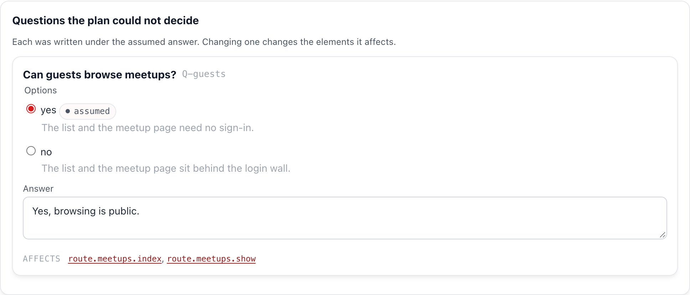
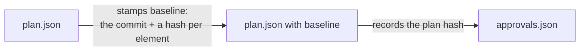

# Chapter 3: Review and Approve

Chapter 2 ended with a list: one open question, five missing behaviours. In this chapter you hand that review to the agent, check what it changed, and approve the plan. Approval is the one step in the loop that only you take.

**What you'll learn:**

- How the Dev Center saves your review where the agent can apply it
- What `plan:revise` records, and why a revision carries a reason
- What approval fixes in place, and the checklist to run before it

## 1. Review in the Dev Center

The Dev Center is part of the dev server, so start it:

```bash run background
bun run dev
```

Open [http://localhost:3333/_guren/plans/meetups](http://localhost:3333/_guren/plans/meetups), the plan's page in the Dev Center. The plan is a draft, so the page asks you to review and approve it. Click **Review this plan**. It opens `/_guren/plans/meetups/review`: the page `plan:render` wrote in chapter 2, served by the dev server so that your review is saved as you make it.

Three kinds of input on it become feedback:

| On the page | Becomes |
|---|---|
| An option picked under a question | the answer; the plan must drop the question |
| **Approve** on an element | a lock: the element may change later only with a stated reason |
| **Request changes** plus a comment | a note the agent reads; nothing enforces it |

For this plan:

1. Under **Can guests browse meetups?**, keep **yes** selected and write "Yes, browsing is public." in the answer box.
2. On `route.meetups.store`, leave the policy warning alone. It is a choice you made in chapter 2.
3. Check the footer: it reads **Review saved at** and a time once your answer is on disk.



Each verdict, comment and answer goes to `.guren/plans/meetups.feedback.json` a moment after you make it, and the page loads it again when you come back. Git ignores the file, like everything under `.guren/plans/`. Nothing else changes: `plan.json` is still what the agent wrote, and `plan:approve` finds the question open until the agent applies your review.

**Without the dev server:** open `docs/plans/meetups/plan.html` from disk and review it the same way. Nothing is saved there, so click **Copy prompt for the agent** at the bottom: it copies a prompt that carries the whole review as JSON. Send that prompt in place of the first line of the one in the next section.

## 2. Hand the review to the agent

Go back to the plan's page in the Dev Center. Its **Review** card now counts what you saved (`1 answered`) and gives you the message to send the agent, with a copy button.

![The plan's page in the Dev Center after the review. A box headed "Waiting on a person" reads "Review saved" and says to tell the agent to revise the plan from the review. Below it, the Review card has a Review this plan button, a line counting 0 approved, 0 changes requested, 0 commented and 1 answered, and under "Send the agent:" the message "Revise docs/plans/meetups/plan.json from my review with the plan-write skill. The review is saved in .guren/plans/meetups.feedback.json." with a copy button](../../images/agent-course-dev-center-review.png)

The page cannot know about the missing behaviours from chapter 2, so they go below that message. Send this to the Claude Code session:

```text
Revise docs/plans/meetups/plan.json from my review with the plan-write skill. The review is saved in .guren/plans/meetups.feedback.json.

Also add a behaviour for each acceptance warning on the page: unauthenticated for meetups.create and meetups.update, forbidden for meetups.edit, validation for meetups.update. Add a success behaviour for the organizer opening meetups.edit. Keep the meetups.store warning, since any signed-in user may organize a meetup.
```

The `plan-write` skill reads your comments and answers from the saved file, edits a copy of the plan outside the repository, then runs `bunx guren plan:revise` with the copy. Without `--feedback`, `plan:revise` applies the review the Dev Center saved and says so: `Applied the review saved in .guren/plans/meetups.feedback.json.` It refuses the copy if it still holds a question you answered, and it records each change with its reason in `docs/plans/meetups/revisions/0001.json`.

**Without an agent:** pass the changes as operations, each with its reason. If you reviewed in the Dev Center, this command applies that review too and prints the same `Applied the review saved in …` line.

<details>
<summary>plan:revise with five new behaviours and the answered question</summary>

```bash run fallback
bunx guren plan:revise docs/plans/meetups/plan.json --ops - <<'EOF'
{
  "ops": [
    {"op": "remove", "id": "Q-guests", "reason": "Answered: guests can browse meetups."},
    {"op": "modify", "section": "plan", "element": {"title": "Meetups", "summary": "Signed-in users organize meetups with a capacity and edit the ones they organize. Anyone can browse them.", "scope": {"goals": ["Organize a meetup", "Edit your own meetup", "Browse meetups"], "nonGoals": ["Registering for a meetup", "Deleting a meetup"]}, "assumptions": ["Meetups are listed soonest first", "Guests can browse meetups"], "hints": [], "locale": "en"}, "reason": "Record the answer to Q-guests."},
    {"op": "add", "section": "acceptance", "parent": "task.meetups", "element": {"id": "AC-meetups-8", "description": "A guest cannot open the form for a new meetup.", "kind": "unauthenticated", "actor": "guest", "route": "route.meetups.create", "given": [], "expect": {"redirect": "/login"}}, "reason": "A rule on a route with no behaviour has no test."},
    {"op": "add", "section": "acceptance", "parent": "task.meetups", "element": {"id": "AC-meetups-9", "description": "A user cannot open the edit form of someone else's meetup.", "kind": "forbidden", "actor": "user", "route": "route.meetups.edit", "given": ["a meetup organized by another user exists"], "expect": {"status": 403}}, "reason": "A rule on a route with no behaviour has no test."},
    {"op": "add", "section": "acceptance", "parent": "task.meetups", "element": {"id": "AC-meetups-10", "description": "An edit needs at least one seat.", "kind": "validation", "actor": "user", "route": "route.meetups.update", "given": ["the user organizes a meetup"], "input": [{"name": "title", "json": "\"Bun night\""}, {"name": "startsAt", "json": "\"2026-10-20T19:00\""}, {"name": "capacity", "json": "0"}], "expect": {"status": 422, "errors": ["capacity"]}}, "reason": "A rule on a route with no behaviour has no test."},
    {"op": "add", "section": "acceptance", "parent": "task.meetups", "element": {"id": "AC-meetups-11", "description": "A guest cannot edit a meetup.", "kind": "unauthenticated", "actor": "guest", "route": "route.meetups.update", "given": ["a meetup exists"], "expect": {"redirect": "/login"}}, "reason": "A rule on a route with no behaviour has no test."},
    {"op": "add", "section": "acceptance", "parent": "task.meetups", "element": {"id": "AC-meetups-12", "description": "The organizer can open the edit form.", "kind": "success", "actor": "user", "route": "route.meetups.edit", "given": ["the user organizes a meetup"], "expect": {"status": 200}}, "reason": "A policy that denies everyone passes every forbidden test; only the allowed user fails it."}
  ]
}
EOF
```

</details>

## 3. Check what changed

Render the page again:

```bash run
bunx guren plan:render docs/plans/meetups/plan.json
```

Reload the review page. **Needs attention** now holds one warning: the `meetups.store` policy one you kept. **Tasks & acceptance** lists twelve behaviours, and the question is gone. Your earlier marks are not shown: they were given on the version before this revision, and the agent has applied them. For the same reason, the plan's page in the Dev Center now says the saved review is from an earlier version of the plan.

You are done with the dev server for this chapter:

```bash run stop-background
# Press Ctrl-C in the terminal running bun run dev.
```

The revision is on disk as data, so you can read exactly what the agent did:

```bash run
cat docs/plans/meetups/revisions/0001.json
```

Each op names an element and the reason for the change. Six months from now, "why does the plan have AC-meetups-9?" has an answer in the repository.

Commit the revised plan:

```bash run
git add docs/plans
git commit -m "docs: apply the review to the meetups plan"
```

## 4. Before you approve

| Check | Where |
|---|---|
| No check is `fail` | Needs attention |
| No question is open | Questions (the section is gone) |
| Every `warn` left is a choice you can name | Needs attention |
| Every rule you care about is a behaviour | Tasks & acceptance |
| Every route behind a policy has a `success` behaviour for the allowed user | Tasks & acceptance |
| The tree is clean | `git status` |

`plan:approve` enforces the first two and the last. The three in between are yours.

## 5. Approve

```bash run
bunx guren plan:approve docs/plans/meetups/plan.json
```

Approval does two things:



- **The baseline** records the commit and a hash of what the app held for each element. Chapter 7 shows what it is for: noticing when the app moves after approval.
- **The approval** records the plan's hash in `docs/plans/meetups/approvals.json`. Every command that builds the plan checks it, so an edit to `plan.json` after approval stops the build until someone approves again.

Commit both:

```bash run
git add docs/plans
git commit -m "docs: approve the meetups plan"
```

## Where you are

- An approved plan with twelve behaviours and no open question.
- `revisions/0001.json`, the review as data.
- `approvals.json`, which the build commands check.

## Common trip-ups

- **`plan:approve` says the tree is dirty.** Commit the revised plan first. Files the agent left at the app root (a copy of the plan, or a `feedback.json` from the static page) count too; move them out of the repository. The review the Dev Center saved does not count, since Git ignores `.guren/plans/`.
- **The review page says it was rendered from another version of the plan.** `plan.json` changed after `plan:render` last ran. Run the command the page names, then reload.
- **`plan:revise` warns that the review was saved on another version of the plan.** The plan changed after you reviewed it, so `plan:revise` left your review out rather than apply it to elements you never saw in their current form. Render the plan, review it again, and send the agent the message again.
- **`plan:revise` refuses because an answered question is kept.** The copy still has the question in `questions`. The answer belongs in `assumptions`.
- **`plan:revise` says an element the feedback approved changes.** You clicked **Approve** on it. Either the change is wrong, or it needs `--reopens "<why>"`.

## Exercises

1. Edit one word in the approved `plan.json` and run `bunx guren plan:next docs/plans/meetups/plan.json`. Read the refusal, then restore the file with `git checkout docs/plans/meetups/plan.json`.
2. Read `approvals.json`. When you approve the plan in chapter 6, its approvals file also gets a `readings` field, which this one lacks. What does this plan have none of that the second plan will?

<details>
<summary>Exercise 1: hint and an example answer</summary>

Change a word inside a string, such as a behaviour's `description`, so the file is still valid JSON. A file that no longer parses gets a different error.

`plan:next` refuses before it reads the app or marks a step. The message says the plan is not approved at its current hash, so no step of it is handed out: it was edited after approval, or never approved. It ends by telling you to run `guren plan:approve` once the plan says what you mean to build. The approval in `approvals.json` names a hash of the whole plan, so one changed word is enough. After `git checkout`, the hash matches again.

</details>

<details>
<summary>Exercise 2: hint and an example answer</summary>

`readings` records how each planned property of an `alter` element read at the moment of approval.

This plan has no `alter` element. Everything is `add`, except `model.user` and its `id` column, which are `existing`. With nothing to read, its approval holds only the hash, the time and, when git knows your name, who approved. The registrations plan alters `Meetup`, `MeetupResource`, `meetups/Show` and `MeetupController.show`, so its approval also gets `readings`.

</details>

## Next

[Chapter 4: One Step at a Time](./04-one-step-at-a-time.md) hands the approved plan to the agent and follows it through five verified steps.
