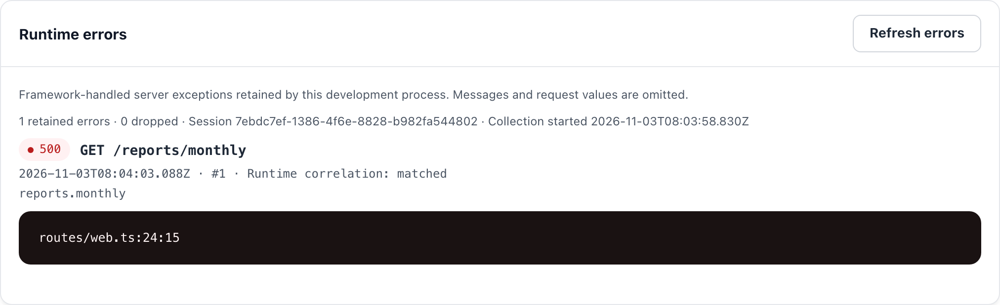
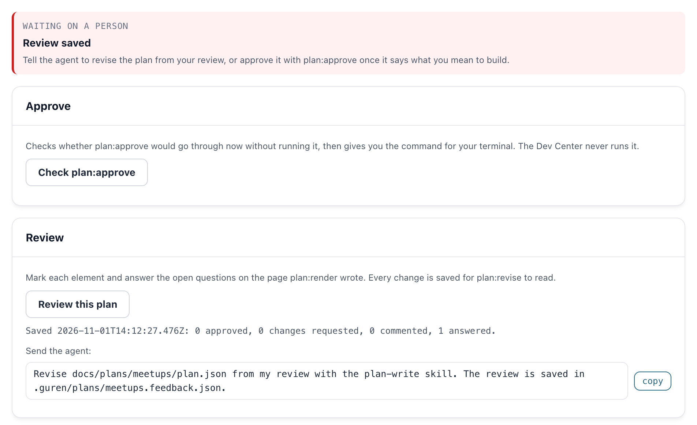
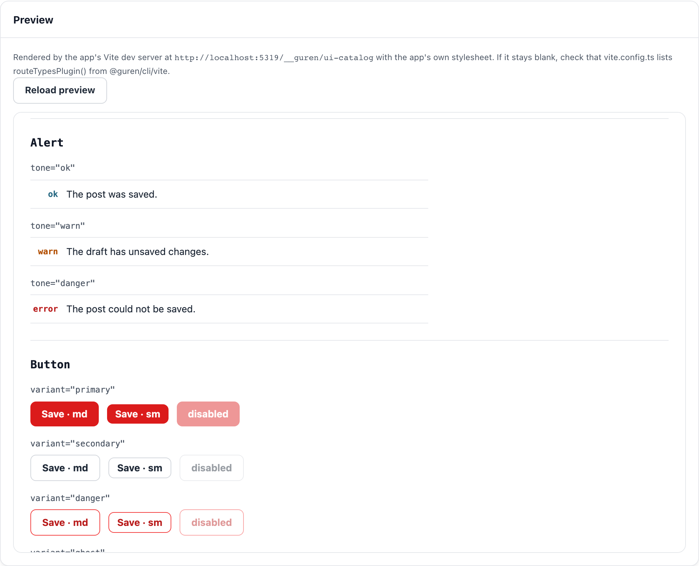

# Application Graph and Runtime Errors

`bunx guren graph` reports how your app is wired: its routes, controllers, models, Inertia pages, middleware, validators, policies and tests, and the evidence that links them. `bunx guren runtime:errors` lists the server errors the running development app hit recently. Coding agents read the same data over MCP, and the Dev Center shows both in a browser.

| Tool | Needs the dev server | Section |
|---|---|---|
| `guren graph` | No: it reads the project on disk | [The application graph](#the-application-graph) |
| `guren runtime:errors` | Yes, with the MCP endpoint enabled | [Runtime errors](#runtime-errors) |
| MCP tools for coding agents | Yes, with the MCP endpoint enabled | [Reading from a coding agent](#reading-from-a-coding-agent) |
| Dev Center | Yes, with the MCP endpoint enabled | [Dev Center](#dev-center) |

The scaffolded `bun run dev` already enables the MCP endpoint (`GUREN_MCP=1`) and the docs viewer (`GUREN_DOCS=1`); the commands below spell the variables out for an app whose `dev` script does not. All of them are development tools. Production never enables runtime error collection or the Dev Center.

## The application graph

```bash
bunx guren graph --json
bunx guren graph --json --no-introspect
```

The JSON includes `schemaVersion`, `snapshot`, `nodes`, `edges`, `unresolved`
and `coverage`. The schema ships at
`node_modules/@guren/cli/assets/application-graph.schema.json`. IDs distinguish
source files and modules. Duplicate routes keep separate IDs and registration
order. A relationship based only on a matching name stays unresolved.

### How the graph is collected

By default, `graph` registers the application in an isolated process without
booting it. It also imports controller, bound-model and validator files to match
class and schema identities, so top-level application code still runs.

`--no-introspect` reads source only. Registered routes, middleware and the
relationships that start at a route (`handles`, `binds`, `usesMiddleware`,
`tests`) are then unavailable, and `validates` and `authorizes` keep only their
source half, reported as partial coverage.

### Where each relationship comes from

Each relationship comes from a reader other commands already use:

- `handles`, `binds` and `usesMiddleware` come from registered routes. A
  middleware node is an alias or group the router registers. Inline middleware
  has no identity, since two handlers can share a function name, so it stays
  unresolved. Middleware added with `app.use()` is not part of a route's chain
  and does not appear.
- `validates` links a controller to the validator export it passes to
  `validateBody()`, `validateQuery()` or `validateParams()`, and a route to the
  validator export its `params`, `query` or `body` contract schema is. A schema
  declared outside the validator files, in the controller file for example,
  stays unresolved.
- `authorizes` links a controller to a policy class its action imports and
  names. `this.authorize()` and `this.can()` reach a policy through the
  `gate.policy()` binding a provider makes at boot, which the graph does not
  run, so those calls stay unresolved with the policy named after the model as
  a candidate. Authorization middleware is reported the same way. A
  model/controller relation in the graph does not prove authorization.
- `tests` links a test file to each route its `TestApp` requests reach, read the
  same way as a rendered plan's
  [Impact section](./implementation-plan-verification.md#impact). A request
  found is not a test passed. A request no registered route answers is listed as
  unresolved without making the section partial.

An absent optional directory is empty; unreadable or unsupported source is
reported as partial coverage. With an older server, model bindings without
identity information remain unresolved.

### Exit codes and snapshots

A complete, stable graph exits 0. Partial coverage, unavailable sections or source
changes during collection exit 1 **with the graph still on stdout**. An
application that authorizes through the gate or uses inline middleware exits 1
for that reason, so consumers should parse the JSON even then.
A collection or output-limit failure instead returns
`{ "schemaVersion": 1, "error": { "code": "…", "message": "…" } }`.
Graph output is limited to 8 MiB.

The snapshot hash includes graph content and source fingerprints, excluding the
capture time. A fresh read observes uncommitted edits. Files read from the project
are compared before and after registration; a change sets
`snapshot.consistency` to `changed`. Dependencies, dotfiles and generated build
directories are outside this source comparison. This is not a filesystem
transaction or evidence that a test passed.

## Runtime errors

To read failures from the running development application, enable its MCP
endpoint and address the origin it reports:

```bash
GUREN_MCP=1 bun run dev
```

From another terminal:

```bash
bunx guren runtime:errors --json --url http://127.0.0.1:3333
bunx guren runtime:errors --json --url http://127.0.0.1:3333 --limit 100
```

Replace the port with the bound port. The client accepts an explicit HTTP
loopback origin, rejects credentials and redirects, and times out after five
seconds. The endpoint keeps the MCP endpoint's loopback check on the caller's
address and `Origin` header, including the explicit
`GUREN_ALLOW_UNVERIFIED_PEER` override for runtimes that report no peer address.

To page through the feed, pass `nextCursor.sessionId` as `--session` and
`nextCursor.after` as `--after` on the next read.

### What is retained

Each application retains at most 100 server-error events for 15 minutes, bounded
by 8 KiB per event and 256 KiB total. Events contain the exception's HTTP status,
method, a registered route when identifiable, and existing project-relative
stack locations. They omit exception messages, request values, headers, cookies
and raw stack text. A custom renderer can return a different response status.

`status: "unavailable"` means collection could not be read; it is distinct from
an available empty feed. `dropped` reports discarded events, and `cursorExpired`
reports a cursor outside retained history or from another session. Stopping the
application clears its buffer and changes the session ID. Custom error handlers
that bypass Guren's exception handler, excluded exception classes, browser
errors, logs, background jobs and failed tests are outside this feed.

## Reading from a coding agent

Coding agents can use `guren_get_application_graph` and
`guren_get_runtime_errors` through `/_guren/mcp`. The latter reads the same data
as `/_guren/runtime/errors` and the CLI. MCP takes `sessionId`, `after` and
`limit` directly. The default limit is 20, with a maximum of 100.

The same endpoint serves `guren_get_plans`, which lists the
[implementation plans](./implementation-plans.md) the docs viewer at
`/_guren/docs` shows: every plan not closed at its current hash, including
drafts nobody has approved yet. Each plan comes with its approval, each step
with the outcome its last `plan:verify` recorded (the values are in
[Plan states](./glossary.md#plan-states)), its waivers, and the next command. `active` names
the step `plan:next` marked in each plan, with its `stall` once the Stop hook
gave up on it. `unreadable` names plan directories that would not list
(app-relative, `.` for the app root, with the error), the same ones the docs
viewer shows above its plan list. The tool reads plan files and `.guren/plans/`
only, so it runs no verification and never imports the application. Run
`plan:status` for the state of each planned element.

## Dev Center

Start the development server with the MCP endpoint enabled, then open
`http://localhost:3333/_guren` (use your app's port):

```bash
GUREN_MCP=1 GUREN_DOCS=1 bun run dev
```

The Dev Center displays the same application graph as `guren graph` and the
same retained errors as `guren runtime:errors`. Select a route to inspect its
related symbols and evidence, or filter by symbol kind, name, file or module.
Coverage and unresolved relationships remain visible when a reader cannot
establish a relationship. A snapshot marked as changed needs another read.


The page reads once when opened. **Refresh graph** starts a fresh scan, which
can import application modules as described in
[How the graph is collected](#how-the-graph-is-collected); **Refresh errors**
replaces the displayed retention window. Neither button runs verification
commands. A failed read shows unavailable data and clears the previous result.
An empty error window means no retained exceptions, not that the application is
healthy.



**Docs & plans** opens the docs viewer at `/_guren/docs`, including its
plan views. That viewer requires `GUREN_DOCS=1`. The Dev Center itself requires
`GUREN_MCP=1` and the same loopback check as the MCP endpoint; it is disabled in
production. Older CLI versions without the page factory keep their MCP tools but
do not mount the Dev Center. Upgrade Guren if `/_guren` returns 404.

### Plans

The top of the page lists the plans not closed at their current hash, with the
ones waiting on a person first: a draft to approve, a plan edited after it was
approved, a step the Stop hook stalled on, or a plan whose every step is
verified and is ready to close. Each card opens `/_guren/plans/<slug>`, which
shows every step by task with its last `plan:verify` outcome, the step
`plan:next` marked, the waivers, and the commands the records say come next.
`plan:next` and `plan:verify` print that path, so an agent can hand it over when
the next decision is yours.

**Review this plan** on that page opens `/_guren/plans/<slug>/review`, the page
`plan:render` wrote, served so that each verdict, comment and answer is saved to
`.guren/plans/<slug>.feedback.json` as you make it. The plan page then counts
the saved review and gives you the message to send the agent; `plan:revise`
applies the file when it is run without `--feedback`. That route is the Dev
Center's one write: it takes the review document from the page's own origin,
for the plan as it stands, and runs no command. Approving stays `plan:approve`.

Where a decision is yours, the plan page offers a check for it: **Check
plan:approve** on a draft or a plan edited after approval, **Check plan:close**
once every step is verified, and **Waive an element** on a stalled step, which
lists the step's elements with a field for your reason. A check runs the command
with `--dry-run` in a separate process and shows whether it would go through, or
the refusal it would print. Then it gives you the command to copy and run in your
own terminal. A waiver's reason is quoted into that command in the page and never
sent to the server. The page never runs the command itself: the Dev Center cannot
tell you from an agent's browser pointed at the same server, so approving,
waiving and closing stay commands you run.



Each step on the plan page has an **Evidence** section, so you can judge the
step without asking the agent:

- **Runtime errors**: the retained server errors whose registered route has the
  method and path of a route the step touches. Those routes come from the plan
  alone: the step's own routes, the routes to its actions and controllers, the
  routes its views render from or submit to, and its behaviours' routes. A step
  that touches none says so, and an error the collector could not tie to one
  route is never counted.
- **plan:verify**: the outcome of the step's last run, the files it
  fingerprinted, and the work measured for the step (files touched and lines
  changed since `plan:next` marked it).
- **Browser runs**: the steps `guren browser:record` recorded under
  `.guren/browser/` whose id is one of the step's acceptance ids, or that belong
  to a run of a feature the step renders, with the result, the reason
  `browser:record` lowered it, the error window and the screenshots. The newest
  50 runs are read. A screenshot is served from
  `/_guren/browser/<run>/screenshots/<sha256>` only while the file still has the
  digest its `run.json` records.

The evidence is there for you to read. No plan command reads a browser run, and
none of it counts toward `plan:verify` or `plan:close`.

The plan views read the plan files, their approvals and decision logs,
`.guren/plans/`, `.guren/browser/` and the dev server's retained runtime errors
only; the plan list is the same data as the `guren_get_plans` MCP tool. Apart
from the decision checks, which run a dry run in a separate process, they run
no command and import nothing from the application, so a step that `plan:next`
holds because the application changed since approval appears in `plan:next`'s
output, not on the page. **Refresh plans** and **Refresh plan** read the records
again; nothing on the page polls.

### Components

**Components** in the top bar opens `/_guren/ui`, which lists the components
[`guren add ui`](./cli.md#add-ui) copies into `resources/js/components/ui/`. For
each one it shows whether the app's copy matches the template the installed CLI
ships, is an unedited copy of an earlier release, has been edited, or is not
copied. `guren upgrade` replaces an unedited earlier copy and leaves an edited
one, which `guren add ui <name> --diff` compares with the template. The verdict
comes from the same list of template hashes the `guren-ui-components` doctor
check and `guren upgrade` read.

Below the list, the page renders every copy the app has in each variant and
state its shipped props allow: each Button variant and size, disabled buttons,
inputs with an error, each Alert tone, and Field with several inputs, a hint and
an error. The preview is a page the app's Vite dev server serves at
`/__guren/ui-catalog`, framed in the Dev Center, so the copies render through the
app's own Tailwind build and `resources/css/app.css`, which imports `guren.css`.



The preview needs `routeTypesPlugin()` from `@guren/cli/vite` in
`vite.config.ts`, which scaffolded apps already list, and a running Vite dev
server. An API-only app gets the list without the preview. The examples follow
the props the templates ship, so a variant added to an edited copy has no
example. A copy that no longer exports its component, or throws while
rendering, shows the reason in place of its examples.
