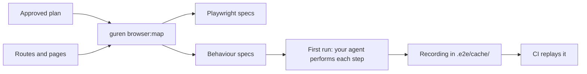

# Browser Tests

`bunx guren add browser-tests` gives your app tests that open it in a real browser. Guren writes the specs from what it already reads: the routes and the pages they render, and the views and behaviours of your approved [implementation plans](./implementation-plans.md). `bunx guren browser:map` rewrites them whenever the app or a plan changes, so there is no spec to keep in step by hand.

The tests come in two layers. The Playwright specs check that each page renders and shows what a plan says it shows. The behaviour specs perform a plan's behaviours: they fill the form, submit it and check where the page lands. Your coding agent performs a step the first time it runs, the runner records what the agent did, and CI replays the recording with no model and no login.



## What the Specs Check

| Spec | One test per | What it checks |
|------|--------------|----------------|
| `tests/browser/generated/smoke.browser.ts` | Feature in the browser map | The feature's first page without a path parameter answers 200 with the component its route renders |
| `tests/browser/generated/plans/<plan>.browser.ts` | View of an approved plan | Every form label and action name the plan gives the view is visible on the page |
| `tests/browser/generated/a11y.browser.ts` | Each of those pages | axe finds no WCAG 2.0 to 2.2 A or AA violation |
| `tests/browser/behaviours/generated/<plan>.e2e.ts` | Behaviour of an approved plan | Performing the behaviour ends where the plan says: the redirect, the labels and actions of the page it lands on, `aria-invalid` on each field the plan expects an error for |

`TestApp` stays the place for what a browser cannot show, such as a status code, a database row, or what a guest or a user without permission gets. See [Testing](./testing.md).

## Set Up the Playwright Specs

```bash
bunx guren add browser-tests
bunx playwright install chromium
bun run test:browser
```

The first command writes `playwright.browser.config.ts` and `tests/browser/support.ts`, adds the `test:browser` script and the `@playwright/test` and `@axe-core/playwright` dev dependencies, and runs `bunx guren browser:map` once to write the specs. Playwright runs under Node, so Node 20.12 or later has to be on `PATH`.

The config starts your app through `bunx guren browser:serve` on `127.0.0.1:4317`. That command refuses to start under `NODE_ENV=production` or against a database it cannot show is local, so a test run cannot reach production data.

When the app signs in with a password (the `users` table and `POST /login` route that `bunx guren add auth` writes), the command also writes a sign-in setup and a seeder for one account, `browser@example.test`. Set its password in `.env` before the first run:

```bash
BROWSER_TEST_PASSWORD=choose-a-password
```

The seeder creates the account only while `browser:serve` runs the app, and does nothing in any other run or in production.

A page the specs cannot open becomes a `test.fixme` that says why (every route to it takes a path parameter, no route renders it yet, or it needs a signed-in user the app cannot provide). It shows up as skipped and never as passing. To leave an axe rule or a part of the page out of the accessibility check, edit `tests/browser/a11y.ts`, which is yours.

## Keep the Specs Current

Run `bunx guren browser:map` again after you approve a plan, add a route or move a page. It rewrites the generated specs and removes one that no feature or plan produces any more.

```bash
bunx guren browser:map          # rewrite the browser map and the generated specs
bunx guren browser:map --check  # write nothing; exit 1 while a generated spec is out of date
```

`--check` suits CI: a pull request that changes a page without regenerating its specs fails there. `browser:map` refuses to overwrite a file under a `generated/` directory that lacks the generated header, so put specs of your own beside that directory.

`guren gate` does not run browser tests. Run them as their own CI step.

## Perform a Plan's Behaviours

A plan's acceptance behaviours say what the app does: a signed-in user creates a post and lands on it, a title of spaces is refused. To perform them in the browser, add `--behaviours` and name the coding agent whose login runs the steps:

```bash
bunx guren add browser-tests --behaviours --agent claude-code
```

`--agent` takes `claude-code`, `codex` or `none`, and has no default. From then on `browser:map` also keeps `tests/browser/behaviours/generated/<plan>.e2e.ts`, with one test per behaviour. A generated test reads like this:

```ts
test('AC-posts-store-1 (b07536): a signed-in user creates a post', { session: 'browser' }, async ({ app, agent, screen, browser }) => {
  const start = await begin('AC-posts-store-1', undefined, { app, browser })
  await browser.goto('/posts/create', { waitUntil: 'networkidle' })
  await expectDefaultLocale(browser)
  const off = await browser.onDialog('accept')
  await agent.act('set "Title" to {title}, then submit the form', { params: { title: 'Measured post' } })
  await off()
  await expect(browser).toHaveURL(landed(['/posts/', { not: ['create'] }], start))
  await expect(screen.getByRole('button', 'Edit').or(screen.getByRole('link', 'Edit')).first()).toBeVisible()
  await expect(screen.getByRole('button', 'Delete').or(screen.getByRole('link', 'Delete')).first()).toBeVisible()
})
```

The test opens the page the behaviour starts on, waits for the network to go quiet so that the page has hydrated, and performs the behaviour. The agent gets one instruction built from the plan, and only for the step itself. Everything after it is an ordinary locator: the URL the browser landed on, and the labels and actions the plan gives the page it lands on. A model never decides whether the test passed.

Where the plan names every control a behaviour touches (each input a labelled field of the form, and an action for the route), the step is written with locators too, and needs no agent at all.

A behaviour becomes a test when its kind is `success` or `validation`, its route is not a `GET`, and a view of the plan submits its form to that route or has an action for it. Every other behaviour becomes a skipped test whose title says why, so the file still holds one test per behaviour.

A behaviour whose start page takes a path parameter (`/posts/:id/edit`) needs a record to open. Give it one in `tests/browser/behaviours/given.ts`, which is yours to edit:

```ts
export const given: Record<string, (fixtures: GivenFixtures) => Promise<Record<string, string> | void>> = {
  'AC-posts-update-1': async ({ browser }) => {
    await browser.goto('/posts/create', { waitUntil: 'networkidle' })
    await browser.locator('input[name="title"]').fill('Given post')
    await browser.locator('button[type="submit"]').tap()
    await browser.waitForURL(/\/posts\/\d+$/u)
    return { id: new URL(await browser.url()).pathname.split('/').at(-1)! }
  },
}
```

## Record Once, Replay in CI

The behaviour specs run on the [e2e](https://github.com/e2e-inc/e2e) runner, which records what the agent did in each step under `.e2e/cache/`. Two scripts run them:

```bash
bun run test:behaviours       # replays recorded steps, runs the others on the model and records them
bun run test:behaviours:ci    # replays only (--strict-cache)
```

Run `bun run test:behaviours` on your machine after approving a plan or changing a page, and commit `.e2e/cache/`. A recording is test data, so its diff belongs in the commit that changed the page. CI runs `bun run test:behaviours:ci`, which needs no login and no API key.

Measured on a small app, a step run on the model took about ten seconds and 41,000 tokens with Claude Code (`sonnet`), over 85% of them cache reads. A recorded step replays without calling a model, so your agent's login is used only the first time a step runs and after the page has changed under its recording. A recording made under Claude Code replays under Codex, and the other way round.

Make recordings against an empty database, which is what CI starts from. [The reference below](#reference-behaviour-specs) shows how to give these runs a database of their own.

## When a Page Changes

A recording holds the actions of a step and what the page showed when the step ended. Rename the button the step taps, and the replay in CI fails with `REPLAY_STALE` instead of calling a model. The exit code of `bun run test:behaviours:ci` says what happened:

| Exit code | Meaning | What to do |
|-----------|---------|------------|
| 0 | Every step replayed | Nothing |
| 1 | A check after a step did not hold | The page does something other than what the plan says. Correct the page or the plan |
| 2 | `REPLAY_STALE`: a recording no longer matches the page | Run `bun run test:behaviours` on your machine. If it passes, commit the new recording. If it fails, the page no longer does what the plan says |
| 3 | A step has no recording, and CI has no login to run it with. The same code means the app did not start | Run `bun run test:behaviours` on your machine and commit the recording |

After a failed run, leave `.e2e/cache/` uncommitted until the page or the plan is corrected. The [reference below](#reference-behaviour-specs) has the full table.

## What the Agent Can Touch

The agent gets the step's own tools and nothing else: no shell, no files, no MCP servers. The config passes every variable your env files set to the agent as an empty string, `BROWSER_TEST_PASSWORD` included. The runner types the password itself, and the agent never receives it.

A variable that only your shell exports does reach the agent, so export no secret in the shell you run these tests from.

## Without an Agent

`--agent none` sets up the runner with no agent:

```bash
bunx guren add browser-tests --behaviours --agent none
```

The behaviours the plan names every control of run as locator steps, with no login and nothing to record. A behaviour that would need an agent step becomes a skipped test that says so. To add an agent later, run the command again with `--agent claude-code --force`, which rewrites the config and keeps `given.ts` and the recordings.

## Reference: `add browser-tests`

Every file and option the commands write, for when the walkthrough above leaves a question open.

`add browser-tests` sets up Playwright browser tests. They start your app through `bunx guren browser:serve`, which refuses production and any database it cannot show is local. The command writes `playwright.browser.config.ts`, which starts the app on `127.0.0.1:4317` and its Vite dev server from port 4318 (`browser:serve` sets `GUREN_VITE_PORT` to the port after the app's unless you set it), and `tests/browser/support.ts`, then runs `bunx guren browser:map`, which from then on keeps two kinds of spec under `tests/browser/generated/`:

- `smoke.browser.ts`, one test per feature in the browser map: the feature's first page without a path parameter must answer 200 with the component its route renders;
- `plans/<plan>.browser.ts` for each approved plan with views: every form label and action name the plan gives a view must be visible on the first page without a path parameter that renders it.

The config sets Playwright's `locale` to the app's default locale, read from `createApp({ i18n })` (the `fallback`, else the first `supported` locale; `en`, with a warning, when the command cannot read one), because plan labels are written in that locale and the server would otherwise pick one from the browser's `Accept-Language`. The setup project clears the `locale` cookie before saving the signed-in session, and each plan spec checks that `_i18n.locale` on the page equals `_i18n.fallbackLocale` before it looks for a label, so a page rendered in another locale fails with a message naming the config line rather than as missing labels. When the app's default locale changes, change `LOCALE` in `playwright.browser.config.ts`.

A page the specs cannot open (every route to it takes a parameter, no route renders it yet, or it needs a signed-in user the app cannot provide) becomes a `test.fixme` that says why, so it shows up as skipped rather than passing. Run `bunx guren browser:map` again after approving a plan; `--check` exits 1 while a generated spec is out of date. It removes a generated spec no feature or plan produces any more, and refuses to overwrite a file under `tests/browser/generated/` that lacks the generated header, so put specs of your own beside that directory.

When the app signs in with a password (the `users` table `make:auth` writes and a `POST /login` route), the command also writes a setup project, `tests/browser/auth.setup.ts`, and a seeder, `db/seeders/browser-account.ts`. The seeder creates `browser@example.test` with the password in `BROWSER_TEST_PASSWORD` while `browser:serve` runs the app, and does nothing in any other run or in production. Set `BROWSER_TEST_PASSWORD` in `.env` before the first run. The seeder runs through boot-time seeding, so `config/database.ts` has to pass `seedOnBoot` to `defineDatabaseConfig()`; the command warns when it does not.

It adds a `test:browser` script (`playwright test -c playwright.browser.config.ts`) and the `@playwright/test` dev dependency (`--no-install` prints the `bun add` command instead), and adds `test-results/`, `playwright-report/` and `tests/browser/.auth/` to `.gitignore`. A `test:browser` script that runs something else makes the command stop before writing anything; `--force` replaces it. Install a browser with `bunx playwright install chromium`, then run `bun run test:browser`. Playwright runs under Node, so Node 20.12 or later has to be on `PATH`.

Spec files end in `.browser.ts`, because `bun test` collects `*.spec.ts`. `guren gate` does not run browser tests.

## Reference: Behaviour Specs

`add browser-tests --behaviours --agent claude-code` sets up tests that perform an approved plan's behaviours in the browser. A test opens the page the behaviour starts on, waits for the network to go quiet so that the page has hydrated, and performs the behaviour. Where the plan names every control it touches (each input a labelled text, number, checkbox or select field of the form, and an action for the route), the test fills the fields and taps the action with ordinary locators, which needs no model. Otherwise it hands your coding agent one instruction built from the plan (`set "Title" to {title}, then submit the form`). Either way it then checks the outcome with ordinary locators: the redirect, the labels and actions of the page it lands on, and `aria-invalid` on each field the plan expects an error for. The tests run on the [e2e](https://github.com/e2e-inc/e2e) runner, which records what the agent did in each step. A recorded step replays without calling a model, so your agent's login is used only the first time a step runs and after the page has changed under its recording.

`--agent` is required and has no default: it names the agent whose login runs the steps, `claude-code` or `codex`. A recording made under one replays under the other. `--agent none` sets up the runner with no agent: only `e2e` and `@e2e-dev/web` are installed, the behaviours the plan names every control of run as locator steps with no login and nothing to record, and a behaviour that would need an agent step is a skipped test that says so. To change agents later, run the command again with `--force`, which rewrites the config and keeps `given.ts` and the recordings. Switching to `--agent none` this way also removes `@e2e-dev/acp` and the agent's adapter (`--no-install` prints the `bun remove` command instead). `browser:map` writes an agent step only while `e2e.browser.config.ts` imports an executor from `@e2e-dev/acp` and the app declares that package. The command writes these files once:

- `e2e.browser.config.ts`, which starts the app through `bunx guren browser:serve` on `127.0.0.1:4319` and never attaches to a server that is already running;
- `tests/browser/behaviours/given.ts`, which is yours to edit (see below);
- `tests/browser/behaviours/auth.setup.e2e.ts`, only when the app signs in with a password. It signs in as the seeded account the Playwright setup uses and saves the session the tests run under.

It adds the `test:behaviours` and `test:behaviours:ci` scripts, installs `e2e`, `@e2e-dev/web` and `@e2e-dev/acp` at exact versions with the chosen agent's adapter (`--no-install` prints the `bun add` command instead), and adds `.e2e/*` and `!.e2e/cache/` to `.gitignore`. From then on `bunx guren browser:map` keeps `tests/browser/behaviours/generated/<plan>.e2e.ts`, with one test per behaviour.

A behaviour becomes a test when its kind is `success` or `validation`, its route is not a `GET`, and a view of the plan submits its form to that route or has an action for it. Every other behaviour becomes a skipped test whose title says why: a kind only `TestApp` can pin (a guest, a user without permission, a missing record), a behaviour that leaves nothing for a browser to check, or a validation input the form's own control stops before a request is sent. A behaviour whose start page takes a path parameter (`/posts/:id/edit`) needs an entry in `given.ts` that creates the record and returns the parameter's value. Without one the test is skipped when it runs, and the reason names the missing entry.

```ts
export const given: Record<string, (fixtures: GivenFixtures) => Promise<Record<string, string> | void>> = {
  'AC-posts-update-1': async ({ browser }) => {
    await browser.goto('/posts/create', { waitUntil: 'networkidle' })
    await browser.locator('input[name="title"]').fill('Given post')
    await browser.locator('button[type="submit"]').tap()
    await browser.waitForURL(/\/posts\/\d+$/u)
    return { id: new URL(await browser.url()).pathname.split('/').at(-1)! }
  },
}
```

Two scripts run the tests:

```bash
bun run test:behaviours       # replays recorded steps, runs the others on the model and records them
bun run test:behaviours:ci    # replays only (--strict-cache)
```

Run `bun run test:behaviours` after approving a plan or changing a page, and commit `.e2e/cache/`. A recording is test data, so its diff belongs in the commit that changed the page. Measured on a small app, a step run on the model took about ten seconds and 41,000 tokens with Claude Code (`sonnet`), and about 17 seconds and 65,000 tokens with Codex; over 85% of the tokens were cache reads either way. Four recorded tests replayed in seven seconds. The first run downloads the Chromium build the runner pins, beside the one Playwright installed.

A test that `browser:map` regenerates gets a new title, so it records anew and its old recording stays in `.e2e/cache/`: the runner has no command that removes only the recordings of tests that are gone. To drop them, run `bunx e2e cache clear` and then `bun run test:behaviours`, which runs every agent step on the model again and records it. A test performed with locator steps has no recording, so it leaves none behind.

Make recordings against an empty database, which is what CI starts from. A recording also holds what the page showed when its step ended. One made while a list held rows from earlier runs went stale against an empty database (`REPLAY_STALE`), and one made against an empty database replayed against both. To keep these runs out of your development database, give them a database of their own: add `'--database-url', './data/behaviours.db'` (or the URL of any other local database) to `args` in `e2e.browser.config.ts`, and migrate it with `DATABASE_URL=./data/behaviours.db bunx guren db:migrate`. Before recording, delete that database and migrate it again.

CI runs `bun run test:behaviours:ci`, which needs no login and no API key. A recording made on macOS replays on Linux (measured in a Debian container). On a slim Linux image, install Chromium's system libraries first with `bunx playwright-core install-deps chromium`; without them the browser does not start and the run exits 3. The exit code says what happened:

| Exit code | Meaning | What to do |
|-----------|---------|------------|
| 0 | Every step replayed | Nothing |
| 1 | A test failed | A check after the step did not hold: the page does something other than what the plan says |
| 2 | `REPLAY_STALE`: a recording no longer matches the page | Run `bun run test:behaviours` on your machine. If it passes, commit the new recording. If it fails, the page no longer does what the plan says. The failed run deletes the recording that no longer matched, so leave `.e2e/cache/` uncommitted until the page or the plan is corrected |
| 2 | `MODEL_UNAVAILABLE`: a test has an agent step and the config names no agent | Run `bunx guren browser:map`, which writes that behaviour as a skipped test while `e2e.browser.config.ts` imports no executor from `@e2e-dev/acp`. If the config still imports one but has no `agents` entry, run `bunx guren add browser-tests --behaviours --agent <agent> --force` to name the agent again, or `--agent none --force` to take it out |
| 3 | A step could not run | A step with no recording tried to call the model and found no login (`MODEL_PROVIDER_FAILED`). Run `bun run test:behaviours` on your machine and commit the recording. A test that `browser:map` regenerated after its plan changed has a new title, and so has no recording yet. The same code means the app did not start |

The agent gets the step's own tools and nothing else: no shell, no files, no MCP servers. Across 65 steps of the generated shape run on the model with Claude Code and 52 with Codex, the agent was never refused a tool of its own (`POLICY_DENIED`), which puts the rate under 4.6% and 5.8% at 95% confidence. The config passes every variable your env files set to the agent as an empty string, `BROWSER_TEST_PASSWORD` included, because Bun would otherwise load those files into the agent's process too. An `ANTHROPIC_API_KEY` or `OPENAI_API_KEY` in `.env` is emptied with the rest, and the agent still ran under its own login. The runner types the password itself, and the agent never receives it. A variable that only your shell exports does reach the agent, so export no secret in the shell you run these tests from. What the agent's process reads after it has started was not checked.

With `BROWSER_TEST_PASSWORD` unset, the sign-in setup fails with a message naming the variable, and the tests that need a signed-in user are skipped. `--force` rewrites the config and the setup, never `given.ts`. When the installed `@playwright/test` is older than the `playwright-core` the runner pins, `tests/browser/generated/a11y.browser.ts` can stop typechecking; the command warns about it and prints the `bun add` command that raises the version. `guren gate` does not run these tests either.

## Next Steps

- [CLI Reference](./cli.md) lists the other commands.
- [Implementation Plans](./implementation-plans.md) covers the plans these specs are generated from.
- [Testing](./testing.md) covers `TestApp`, for everything a browser cannot show.
