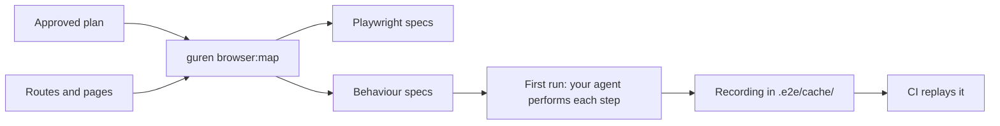

# Browser Tests

`bunx guren add browser-tests` gives your app tests that open it in a real browser. Guren writes the specs from what it already reads: the routes and the pages they render, and the views and behaviours of your approved [implementation plans](./implementation-plans.md). `bunx guren browser:map` rewrites them whenever the app or a plan changes, so there is no spec to keep in step by hand.

The tests come in two layers. The Playwright specs check that each page renders and shows what a plan says it shows. The behaviour specs perform a plan's behaviours: they fill the form, submit it and check where the page lands. Your coding agent performs a step the first time it runs, the runner records what the agent did, and CI replays the recording with no model and no login.



## Why an Agent Performs the Step

A plan states a behaviour as a route, an input and an outcome. How the page takes that input is not in it: which control holds the title, how a date control gets its value, which button sends the form. A browser test written by hand answers that in code, and someone keeps the code in step with the markup. In a behaviour spec the agent answers it once, on the real page, and the recording takes the place of the code.

| | A browser test written by hand | A behaviour spec |
|---|---|---|
| The steps | You write each selector and click | The instruction comes from the plan, and the agent finds the controls on the page |
| A control the plan does not spell out, such as a date control | You script how it takes its value | The agent operates it |
| After a page changes | You edit the steps the change broke | You run `bun run test:behaviours` again and commit the new recording |
| What decides the result | The assertions you wrote | Locators generated from the plan, never the model |

The agent is the Claude Code or Codex you already use, on its own login, so there is no API key to issue. A model is called the first time a step runs and after its page changes. Every other run, CI included, replays the recording.

## What the Specs Check

| Spec | One test per | What it checks |
|------|--------------|----------------|
| `tests/browser/generated/smoke.browser.ts` | Feature in the browser map | The feature's first page without a path parameter answers 200 with the component its route renders |
| `tests/browser/generated/plans/<plan>.browser.ts` | View of an approved plan | Every form label and action name the plan gives the view is visible on the page |
| `tests/browser/generated/a11y.browser.ts` | Each of those pages | axe finds no WCAG 2.0 to 2.2 A or AA violation |
| `tests/browser/behaviours/generated/<plan>.e2e.ts` | Behaviour of an approved plan | Performing the behaviour ends where the plan says: the redirect, the labels and actions of the page it lands on, `aria-invalid` on each field the plan expects an error for |

`TestApp` stays the place for what a browser cannot show, such as a status code, a database row, or what a guest or a user without permission gets. See [Testing](./testing.md).

## Set Up the Playwright Specs

```bash
bunx guren add browser-tests
bunx playwright install chromium
bun run test:browser
```

The first command writes `playwright.browser.config.ts` and `tests/browser/support.ts`, adds the `test:browser` script and the `@playwright/test` and `@axe-core/playwright` dev dependencies, and runs `bunx guren browser:map` once to write the specs. Playwright runs under Node, so Node 20.12 or later has to be on `PATH`.

The config starts your app through `bunx guren browser:serve` on `127.0.0.1:4317`. That command refuses to start under `NODE_ENV=production` or against a database it cannot show is local, so a test run cannot reach production data.

When the app signs in with a password (the `users` table and `POST /login` route that `bunx guren add auth` writes), the command also writes a sign-in setup and a seeder for one account, `browser@example.test`. Set its password in `.env` before the first run:

```bash
BROWSER_TEST_PASSWORD=choose-a-password
```

The seeder creates the account only while `browser:serve` runs the app, and does nothing in any other run or in production.

A page the specs cannot open becomes a `test.fixme` that says why (every route to it takes a path parameter, no route renders it yet, or it needs a signed-in user the app cannot provide). It shows up as skipped and never as passing. To leave an axe rule or a part of the page out of the accessibility check, edit `tests/browser/a11y.ts`, which is yours.

## Keep the Specs Current

Run `bunx guren browser:map` again after you approve a plan, add a route or move a page. It rewrites the generated specs and removes one that no feature or plan produces any more.

```bash
bunx guren browser:map          # rewrite the browser map and the generated specs
bunx guren browser:map --check  # write nothing; exit 1 while a generated spec is out of date
```

`--check` suits CI: a pull request that changes a page without regenerating its specs fails there. `browser:map` refuses to overwrite a file under a `generated/` directory that lacks the generated header, so put specs of your own beside that directory.

`guren gate` does not run browser tests. Run them as their own CI step.

## Perform a Plan's Behaviours

A plan's acceptance behaviours say what the app does: a signed-in user creates a post and lands on it, a title of spaces is refused. To perform them in the browser, add `--behaviours` and name the coding agent whose login runs the steps:

```bash
bunx guren add browser-tests --behaviours --agent claude-code
```

`--agent` takes `claude-code`, `codex` or `none`, and has no default. From then on `browser:map` also keeps `tests/browser/behaviours/generated/<plan>.e2e.ts`, with one test per behaviour. A generated test reads like this:

```ts
test('AC-posts-store-1 (b07536): a signed-in user creates a post', { session: 'browser' }, async ({ app, agent, screen, browser }) => {
  const start = await begin('AC-posts-store-1', undefined, { app, browser })
  await browser.goto('/posts/create', { waitUntil: 'networkidle' })
  await expectDefaultLocale(browser)
  const off = await browser.onDialog('accept')
  await agent.act('set "Title" to {title}, then submit the form', { params: { title: 'Measured post' } })
  await off()
  await expect(browser).toHaveURL(landed(['/posts/', { not: ['create'] }], start))
  await expect(screen.getByRole('button', 'Edit').or(screen.getByRole('link', 'Edit')).first()).toBeVisible()
  await expect(screen.getByRole('button', 'Delete').or(screen.getByRole('link', 'Delete')).first()).toBeVisible()
})
```

The test opens the page the behaviour starts on, waits for the network to go quiet so that the page has hydrated, and performs the behaviour. The agent gets one instruction built from the plan, and only for the step itself. Everything after it is an ordinary locator: the URL the browser landed on, and the labels and actions the plan gives the page it lands on. A model never decides whether the test passed.

Where the plan names every control a behaviour touches (each input a labelled field of the form, and an action for the route), the step is written with locators too, and needs no agent at all.

A behaviour becomes a test when its kind is `success` or `validation`, its route is not a `GET`, and a view of the plan submits its form to that route or has an action for it. Every other behaviour becomes a skipped test whose title says why, so the file still holds one test per behaviour.

A behaviour whose start page takes a path parameter (`/posts/:id/edit`) needs a record to open. Give it one in `tests/browser/behaviours/given.ts`, which is yours to edit:

```ts
export const given: Record<string, (fixtures: GivenFixtures) => Promise<Record<string, string> | void>> = {
  'AC-posts-update-1': async ({ browser }) => {
    await browser.goto('/posts/create', { waitUntil: 'networkidle' })
    await browser.locator('input[name="title"]').fill('Given post')
    await browser.locator('button[type="submit"]').tap()
    await browser.waitForURL(/\/posts\/\d+$/u)
    return { id: new URL(await browser.url()).pathname.split('/').at(-1)! }
  },
}
```

## Record Once, Replay in CI

The behaviour specs run on the [e2e](https://github.com/e2e-inc/e2e) runner, which records what the agent did in each step under `.e2e/cache/`. Two scripts run them:

```bash
bun run test:behaviours       # replays recorded steps, runs the others on the model and records them
bun run test:behaviours:ci    # replays only (--strict-cache)
```

Run `bun run test:behaviours` on your machine after approving a plan or changing a page, and commit `.e2e/cache/`. A recording is test data, so its diff belongs in the commit that changed the page. CI runs `bun run test:behaviours:ci`, which needs no login and no API key.

Measured on a small app, a step run on the model took about ten seconds and 41,000 tokens with Claude Code (`sonnet`), over 85% of them cache reads. A recorded step replays without calling a model, so your agent's login is used only the first time a step runs and after the page has changed under its recording. A recording made under Claude Code replays under Codex, and the other way round.

Make recordings against an empty database, which is what CI starts from. The [CLI reference](./cli.md#behaviour-specs) shows how to give these runs a database of their own.

## When a Page Changes

A recording holds the actions of a step and what the page showed when the step ended. Rename the button the step taps, and the replay in CI fails with `REPLAY_STALE` instead of calling a model. The exit code of `bun run test:behaviours:ci` says what happened:

| Exit code | Meaning | What to do |
|-----------|---------|------------|
| 0 | Every step replayed | Nothing |
| 1 | A check after a step did not hold | The page does something other than what the plan says. Correct the page or the plan |
| 2 | `REPLAY_STALE`: a recording no longer matches the page | Run `bun run test:behaviours` on your machine. If it passes, commit the new recording. If it fails, the page no longer does what the plan says |
| 3 | A step has no recording, and CI has no login to run it with. The same code means the app did not start | Run `bun run test:behaviours` on your machine and commit the recording |

After a failed run, leave `.e2e/cache/` uncommitted until the page or the plan is corrected. The [CLI reference](./cli.md#behaviour-specs) has the full table.

## What the Agent Can Touch

The agent gets the step's own tools and nothing else: no shell, no files, no MCP servers. The config passes every variable your env files set to the agent as an empty string, `BROWSER_TEST_PASSWORD` included. The runner types the password itself, and the agent never receives it.

A variable that only your shell exports does reach the agent, so export no secret in the shell you run these tests from.

## Without an Agent

`--agent none` sets up the runner with no agent:

```bash
bunx guren add browser-tests --behaviours --agent none
```

The behaviours the plan names every control of run as locator steps, with no login and nothing to record. A behaviour that would need an agent step becomes a skipped test that says so. To add an agent later, run the command again with `--agent claude-code --force`, which rewrites the config and keeps `given.ts` and the recordings.

## Next Steps

- [`add browser-tests`](./cli.md#add-browser-tests) and [Behaviour specs](./cli.md#behaviour-specs) in the CLI reference list every file the commands write and every option.
- [Implementation Plans](./implementation-plans.md) covers the plans these specs are generated from.
- [Testing](./testing.md) covers `TestApp`, for everything a browser cannot show.
