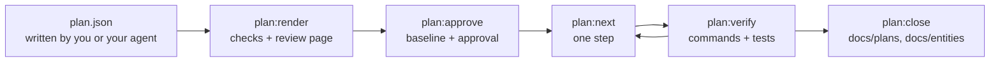

# Implementation Plans

An implementation plan is a design document for a change, written as JSON before any code exists. Guren checks it against your application, renders it as a page a person can review, stamps it when it is approved, breaks it into steps, and then reads from the code which parts of it exist. The agent that implements the plan never reports its own progress: `plan:status` and `plan:verify` derive it from the schema, the route graph, the controllers, the pages and the test results.

A plan is worth writing when a change spans a table, several routes and a page, and the design is cheaper to correct than the diff. If you can describe the diff in one sentence, skip the plan.

For a walkthrough, [Building with an Agent](../agent-course/00-overview.md) takes two plans from request to close with Claude Code, with a checklist for each decision along the way.



The examples on this page come from one plan, comments on posts, run against a copy of Guren's [blog example](https://github.com/gurenjs/guren/tree/main/examples/blog).

## Terms

The page uses these words in a fixed sense. Each is explained in full in its section.

| Term | Meaning |
|---|---|
| Element | One thing the plan names: a model, column, route, action, validator, page, resource, policy, command or side effect. Each has an id such as `model.comment` ([Ids and changes](./implementation-plan-format.md#ids-and-changes)) |
| Change | What the plan does to an element: `add`, `alter`, `rename`, `drop`, or `existing` for one it only refers to |
| Behaviour | An acceptance criterion with an id such as `AC-comments-1`, which becomes a test ([Acceptance behaviours](./implementation-plan-format.md#acceptance-behaviours)) |
| Baseline | The commit and the per-element hashes the first approval stamps into the plan ([Approving](#approving-planapprove)) |
| Plan hash | A hash of the plan and its baseline. Approvals, verification records and waivers name it, so an edited plan is a different plan |
| Reading | What an `alter`'s planned property read at approval ([Readings of an `alter`](./implementation-plan-verification.md#readings-of-an-alter)) |
| Task, step | The work Guren derives: mostly a task per entity, plus tasks for shared work, split into steps of six kinds ([Implementing](#implementing-plannext-and-planverify)) |
| Record | A step's verification result, kept in `.guren/plans/` |
| State | How far an element is: `planned`, `present`, `wired`, `verified`, `drifted`, `unjudged`, `blocked` or `waived` ([Reading progress](#reading-progress-planstatus)) |
| Reach | Whether a passing behaviour exercises an element, following the plan's references from its route and expected page ([rules](./implementation-plan-verification.md#when-an-element-counts-as-complete)) |
| Fresh, stale | Whether what an element depends on still matches the baseline ([Freshness](./implementation-plan-verification.md#freshness)). `plan:next` holds back a step whose context went stale |
| Waiver | A person accepting an element incomplete, with a reason ([Waiving](#waiving-an-element-planwaive)) |

## Where a plan lives

A plan is a directory under `docs/plans/`, named by its slug:

| File | What it is | Committed |
|---|---|---|
| `docs/plans/comments/plan.json` | The plan | yes |
| `docs/plans/comments/approvals.json` | The hashes `plan:approve` recorded, with the readings of each `alter` | yes |
| `docs/plans/comments/decisions.json` | Waivers, written by `plan:waive` | yes |
| `docs/plans/comments/revisions/0001.json` | Revisions, written by `plan:revise` | yes |
| `docs/plans/comments/plan.html` | The page `plan:render` writes | no |
| `.guren/plans/comments.state.json` | Verification results and the marked step | no, it ignores itself |

The slug is the directory name for a file called `plan.json`. Any other name works too: `comments.plan.json` has the slug `comments`, and keeps its records beside it as `comments.approvals.json`, `comments.decisions.json` and `comments.revisions/`.

The rendered page is generated output and belongs out of the repository. `plan:next` ignores it and its temporary file where `plan:render` writes them by default, so it does not have to be ignored for the loop to run, but it should not be committed either. A page written elsewhere with `-o` is an ordinary untracked file, and `plan:next` refuses the tree it sits in. An app scaffolded by `create-guren-app` already ignores both default locations; an older app adds the two patterns to its `.gitignore`. The first covers the `docs/plans/<slug>/` layout, the second a plan named `<slug>.plan.json` anywhere else, such as the application root:

```text
docs/plans/**/*.html
*.plan.html
```

The plan, its approvals, its decision log and its revisions are a different matter: `plan:next` refuses while one of them is uncommitted, since a waiver decides which step it hands out and a revision belongs in the commit that changes the plan.

## Writing a plan

You write the JSON, or your agent does in the session where you discussed the feature. `guren plan --print-prompt` prints what that agent needs: a prompt with your request and the conventions on this page, then the plan's JSON Schema. It calls no model and runs nothing.

```bash
bunx guren plan "comments on posts, authors can delete their own" --print-prompt
```

Paste the output into the session, or have the agent run the command itself. The prompt has the agent read the application with `context`, `model:list` and `guidelines`, ask you what it cannot decide, write `docs/plans/<slug>/plan.json`, and run `plan:render --json` until no check fails. Approving stays with you. Without a request, the prompt tells the agent to ask you for one, and `--json` prints the prompt and the schema as one object. Without `--print-prompt`, `guren plan` exits with an error: the form that asks a model for the plan by itself is not available yet (see the end of this page).

In an app whose agent harness is installed (`bunx guren agent:init`, refreshed by `agent:sync`), the `plan-write` skill runs this for you. Ask your agent to plan the feature: it asks you the questions that change the design before writing anything, writes the plan from the prompt, runs `plan:render --json` until no check fails, and tells you where the page is and what is still open. After your review it records your changes with `plan:revise`. It never approves the plan; once you have, the `plan-implement` skill builds it.

`plan:render` validates the file against the plan schema and names the field at fault:

```text
 ERROR  The plan does not match the plan schema:
  models.0.columns.0.change.from: Invalid input: expected string, received undefined
```

The plan's sections, element ids, acceptance behaviours, questions and commands are described in [Writing an Implementation Plan](./implementation-plan-format.md).

## Rendering and checking: `plan:render`

```bash
bunx guren plan:render docs/plans/comments/plan.json
```

It writes `docs/plans/comments/plan.html` and prints the path. `-o` writes somewhere else, `--app <dir>` names the application to check against when you run it from another directory, and `--locale ja` opens the page's own labels in Japanese (the page switches between `en` and `ja`; the plan's text is never translated). `--json` prints the page's path and every check instead of the path alone, so an agent can read the failing checks without opening the page.

The page is one file with no network access: it opens from disk and can be attached to a review. It has a tab per section, a filter per entity, a "Changes only" toggle that hides `existing` elements, an entity relationship diagram of the plan merged over the current schema, and every id links to the element it names. Failed checks and breaking changes are pinned under "Needs attention". Each element has Approve and Request changes buttons and a comment box, and the footer exports the review as `feedback.json`. Nothing done on the page changes the plan file. **Copy prompt for the agent** copies one message, in the page's language, that names the plan, asks the agent to apply the review with the `plan-write` skill, and carries the feedback, so the review reaches the plan through a revision. `plan:revise` reads its approvals and answered questions (below); the comments are for you or your agent to apply to a copy of the plan. The two commands it prints are the ones that follow a revision, `plan:render` and `plan:approve`.

The checks run against the application as it is now. They report, among others, a route whose action is not in the plan, a foreign key to a model that exists nowhere, an `add` whose name is already taken, an `existing` or `alter` target that does not exist, a mutating route with authentication and no authorization, a body-carrying route with no validator, and the missing behaviours described in [Acceptance behaviours](./implementation-plan-format.md#acceptance-behaviours). Rendering never fails on a check; `plan:approve` does. On a plan with a baseline, `plan:render` settles the same findings approval does, so a collision the plan's own work explains shows on the page as a passing check rather than a blocking one. Renaming the delete route of the example to a name the blog already uses gives:

```text
  route.comments.destroy: The route name "posts.destroy" already exists in this application.
```

For each element the plan alters, renames or drops, the page also lists what in the application depends on it ([Impact](./implementation-plan-verification.md#impact)).

## Approving: `plan:approve`

Approval is a person's decision, made after reading the page. It refuses while a check fails or a question is open:

```text
 ERROR  docs/plans/comments/plan.json is not approved while a check fails or a question is open; an assumption nobody confirmed is not approved by silence.
  question Q-delete is unanswered: Does deleting a comment remove the row?
An answer chosen on the review page does not change the plan file. Send the agent the prompt the page copies with "Copy prompt for the agent", or remove each answered question yourself with plan:revise (--edited with a copy of the plan, or --ops with a remove op), passing the page's feedback with --feedback.
```

Once the plan is clean:

```bash
bunx guren plan:approve docs/plans/comments/plan.json
```

```text
Comments on posts (plan.json)

Stamped the baseline at 0c871a5b9dc25587d33ae3d6bb6c3befe2c7e6a2: 14 element(s) hashed.
Approved 22735cb551ac15559cd5cabc344925f8f75af7a62efe39570ac49d8c032a59c0, recorded in docs/plans/comments/approvals.json.
```

The first approval writes a `baseline` into the plan: `rev`, the commit the plan was written against, and `contextHash`, a hash per referenced element of what the application holds for it today. That is why it refuses a repository with no commit and a working tree with uncommitted changes (the plan's own files excepted). The approval itself goes to `approvals.json`, beside the plan and never inside it. Commit both.

The plan's hash identifies it: a SHA-256 of the plan with its baseline. Approvals, verification records and waivers all name it, so a plan edited after approval is a different plan. `plan:next`, `plan:scaffold`, `plan:verify`, `plan:waive` and `plan:close` refuse a plan with a baseline whose current hash no approval names:

```text
 ERROR  docs/plans/comments/plan.json is not approved at its current hash dc9a6ce3ad173e23290f743293fa0e3495c932b3b2cdf07c0cda8c9b063a5465, so no step of it is handed out: it was edited after approval, or never approved, and what it says now may not be what anyone agreed to. Run guren plan:approve docs/plans/comments/plan.json once the plan says what you mean to build.
```

`plan:status` and `plan:render` keep working, since they are how you read the change before approving it. A draft, which has no baseline and so no hash, is still accepted by `plan:next` and `plan:verify`; `plan:scaffold` refuses one, since it writes code from what someone approved. A draft with approvals recorded beside it is refused like an unapproved plan: deleting `baseline` from an approved plan does not take it out of the gate.

Approve the plan before implementing it: for every `alter`, approval records what each planned property reads, and a property that already matched then proves nothing ([Readings of an `alter`](./implementation-plan-verification.md#readings-of-an-alter)). How validators are hashed, and approving an edited plan again mid-implementation, are in [Approval in detail](./implementation-plan-verification.md#approval-in-detail).

## Revising: `plan:revise`

A plan changes through a revision, before approval and after. `plan:revise` records one without a model. The plan file as it stands is the parent, and the change comes separately: a copy of the plan with the change made in it, or the ops themselves.

```bash
cp docs/plans/comments/plan.json /tmp/comments.edited.json
# edit the copy: rename a column, change a type, drop a route
bunx guren plan:revise docs/plans/comments/plan.json --edited /tmp/comments.edited.json --message "soft-delete comments instead"
```

The command derives the ops from the difference between the two, one op per element added, changed or removed, each with `--message` as its reason. It writes `{ parent, ops, result }` to `docs/plans/comments/revisions/0001.json` and then replaces `plan.json` with the copy. A plan named `comments.plan.json` keeps its revisions in `comments.revisions/`. `--ops ops.json` takes the ops directly, as a `{ "ops": [...] }` document in which each op carries its own `reason`.

With `--feedback feedback.json` (or `-` for the copied text), the page's review becomes a rule. An element approved there changes only when `--reopens "<reason>"` says why, and a question answered there has to be gone from the revised plan. That is all the command reads from the feedback: the comments stay for you to apply to the copy.

After approval, this is how the plan changes. Editing `plan.json` in place moves its hash to one that no approval or revision names, and `plan:revise` refuses that plan: restore it with `git checkout -- docs/plans/comments/plan.json`, keep the edit in a copy, and pass the copy with `--edited`. A plan revised and not yet approved can be revised again. A revision carries the baseline over unchanged, so `plan:next` and the other gated commands refuse the result until `plan:approve` records it, and a waiver taken against the old hash does not carry over; the command lists those waivers. A draft can be revised the same way before its first approval, or edited directly.

Revising a plan that is already implemented brings its steps back to be re-checked; see [Revising an implemented plan](./implementation-plan-verification.md#revising-an-implemented-plan).

## Implementing: `plan:next` and `plan:verify`

Guren derives the work from the plan, and the order does not depend on a model. The loop is: ask for the next step, implement it, verify it, commit. Every entity the plan adds or changes is a task, and work shared by several gets a task of its own. Tasks are ordered by the references between their elements, foreign keys among them. There are six kinds of step, and a task gets only those it has work for:

| Step | Work | Verified by |
|---|---|---|
| `commands` | The plan's `commands`, such as `guren add attachments`, in `task/foundation` | `codegen`, `typecheck` |
| `scaffold` | The first version of a new entity, written by `plan:scaffold` | `codegen`, `typecheck` |
| `tests` | One test per acceptance behaviour, written as a skeleton by `plan:scaffold`, failing | `codegen`, the tests failing |
| `data` | Table, migration, model relationships and fillable; after a scaffold, the migration and what `plan:scaffold` left out | `codegen`, `db:migrate`, `typecheck` |
| `http` | Controllers and routes; validators, resources and policies, or after a scaffold, what `plan:scaffold` left as a stub or unwritten | `codegen`, `typecheck`, `guren check`, the tests passing |
| `pages` | Page components | `codegen`, `typecheck`, `guren check` |

How the work is divided:

- **Tests run on one step per task**, the one its behaviours are judged at: the last `http` step, or the task's last step when it has none, so a `data` or `pages` step can run them too. Any other step, an earlier part of a split `http` step included, runs no tests.
- **Of a split `http` step, only the last part runs `typecheck`**, since an earlier part may import a resource or job a later part writes. The other kinds of step run it as the table shows.
- **A page an `http` action renders** is not in `.guren/pages.gen.ts` until its file exists, so `plan:next` lists it with the `http` step: create it there as a stub with a default export and the plan's `Props`, and write the rest in the `pages` step.
- **Shared work** goes to a `task/foundation` task. An action stays with the task that covers it or the routes to it, even when its controller class is shared, so a task's `tests` step runs before the step that mounts its routes, validators and middleware. A validator or page several tasks use goes to the first of them rather than to Foundation, and the others wait for that task.
- **Step ids** read `task/entity/model.comment/http`. A `commands`, `data`, `http` or `pages` step whose elements span more than five files is split into parts such as `task/entity/model.comment/http/1` and `/2`; `scaffold` and `tests` are never split. `plan:next` prints the exact id to pass to `--step`.

```bash
bunx guren plan:next docs/plans/comments/plan.json
```

```text
Comments on posts (plan.json)

Verified: task/entity/model.comment/scaffold

Next: task/entity/model.comment/tests
  task: entity Comment (task/entity/model.comment)
  verify: codegen → tests:fail

Write this step’s test skeletons with `bunx guren plan:scaffold docs/plans/comments/plan.json --step task/entity/model.comment/tests`, not by hand, then fill them in.
  It writes one TestApp test per behaviour (AC-comments-1, AC-comments-2, AC-comments-3, AC-comments-4), with its request and the expectations the plan states, into one file.
  Each fails at a given() call until the setup it names is written (records, the signed-in actor, path parameters); replace every call, and keep each title’s id and its request.

Behaviours to write, as test titles `[<id>] <description>`, failing:
  [AC-comments-1] A signed-in user can comment on a post.
      success; actor user; route route.comments.store; given a post exists; expect status 303; comments has 1 row(s)
  [AC-comments-2] An empty comment is rejected.
      validation; actor user; route route.comments.store; given a post exists; expect status 422; errors on body
  [AC-comments-3] A guest cannot comment.
      unauthenticated; actor guest; route route.comments.store; given a post exists; expect redirect /login
  [AC-comments-4] A user cannot delete someone else's comment.
      forbidden; actor user; route route.comments.destroy; given a comment written by another user exists; expect status 403
  Each test requests its route through a TestApp, in its body or a function of its file it calls: plan:verify reads the requests before it runs them.

Implement this step only, then run `bunx guren plan:verify docs/plans/comments/plan.json --step task/entity/model.comment/tests` and commit once it is verified.
Marked in .guren/plans/comments.state.json

Dev Center: /_guren/plans/comments on the running dev server shows the person every step of this plan.
```

`plan:next` prints one step and never the whole plan. `--json` prints the same as data. It marks the step in the state file, which is what the Stop hook reads. It refuses a plan no approval names, as above, and a working tree with uncommitted changes unless they are the marked step's own, so run it before you start a step, not after:

```text
 ERROR  The working tree under /app has uncommitted changes (paths relative to the repository root), and one step is one commit. Commit or discard them first:
  ?? tests/plans/comments/comments.test.ts
```

```bash
bunx guren plan:verify docs/plans/comments/plan.json --step task/entity/model.comment/tests
```

```text
task/entity/model.comment/tests: verified (607 ms)
  pass     codegen     bun run codegen
  pass     tests:fail  bun test tests/plans/comments/comments.test.ts
  failing  [AC-comments-1]
  failing  [AC-comments-2]
  failing  [AC-comments-3]
  failing  [AC-comments-4]
  work: 1 file, +38 -0 since 3f1c2a9b0d4e

Recorded in .guren/plans/comments.state.json
```

The `work:` line counts the files and lines the step changed since `plan:next` marked it ([Files and lines per step](./implementation-plan-verification.md#files-and-lines-per-step)).

The `tests` step passes only when every behaviour has a test and each one fails: a test that passes before the code exists proves nothing, and a skipped test is not a failing one. `plan:verify` selects the test files whose source carries the step's ids, and runs them with `bun test`. Later steps run the same files and need them to pass. After the verify output it prints the plan's status, described below.

Before it runs the tests, `plan:verify` checks that each behaviour's test requests the route the behaviour names ([How `plan:verify` reads test requests](./implementation-plan-verification.md#how-planverify-reads-test-requests)).

### Scaffold and tests steps

`plan:next` tells you to write a `scaffold` or `tests` step with `plan:scaffold` rather than by hand, and to mount the routes a scaffold step wrote with `plan:scaffold --mount` from the `http` step. Both leave work for you on purpose: relationships whose keys are not there yet, resource fields that throw, policy methods that return `false`, actions that answer 501, and test setup written as `given()` calls that throw. What each writes and leaves is in [Generating Code and Tests from a Plan](./implementation-plan-scaffolding.md).

### Outcomes

A step ends in one of four outcomes.

| Outcome | Meaning |
|---|---|
| `verified` | Every command passed and every element the step owns is at the state that completes it |
| `failed` | A command failed; there is something in the implementation to fix |
| `incomplete` | The commands passed, but an element is not there yet |
| `blocked` | The environment could not run a command: a script `package.json` lacks, a tool not installed, a timeout, a database that cannot be reached, a migration check with no drizzle-kit or drizzle config, or a drizzle-kit that gives no answer |

Examples of each outcome, and the migration check a `data` step runs before `db:migrate`, are in [Step outcomes in detail](./implementation-plan-verification.md#step-outcomes-in-detail).

`plan:verify` refuses a plan that has a baseline but no approval at its current hash before it runs anything, so nothing is recorded against a hash nobody agreed to. A draft nobody has approved yet still runs, as [Approving](#approving-planapprove) says. Past that, it executes your application: `bun test` boots it and `db:migrate` opens the database it is configured for, so run it against a development or test database, never production. Each command may take 600 seconds before it counts as `blocked`; `--timeout <seconds>` changes that. Without `--step` it runs every step in order and skips the ones whose record still holds; steps whose files changed since they verified are re-checked last, as described next. `--ci` exits 1 when a step it ran did not verify, and `--json` prints the report as data.

### One step, one commit

Change only the elements a step lists, and commit it once it verifies. A verified step records a fingerprint of the files that hold its elements, of the files that wire them (the routes dispatching to an action, the controller returning a page), and of its test files. When one of them changes, the step's elements read `drifted`. A later step often has good reason to write into such a file: a route beside an earlier one in `routes/web.ts`, a table in `db/schema.ts`, a field on a resource. In a copy of the example, a commit after the `pages` step added a field to `CommentResource.ts`, a file the `http` step had verified, so most elements of `http` drifted:

```text
Routes
  drifted   add       comments.store             route.comments.store
      Verified 2026-09-22T10:18:13.443Z by task/entity/model.comment/http; changed since: app/Http/Resources/CommentResource.ts.
```

The elements verified only through a behaviour of `http` (its controller and policy) fell back to the state `plan:status` reads for them, since a step whose files changed carries no reach (see [When an element counts as complete](./implementation-plan-verification.md#when-an-element-counts-as-complete)).

`plan:verify --step` re-checks such steps. Once the given step verifies, the same run re-checks the earlier steps whose files changed, in task order, stopping at the first one that runs commands and does not verify. Each outcome is recorded (a `failed` one names what broke) and listed under "Re-checked"; `plan:next` then returns the earliest step left unverified, usually the one that failed. A re-check that comes out `blocked` is left for a later run. While the given step does not verify, the earlier records are left alone and listed as left for a later run, since the commands the steps share would fail them too.

A `tests` step is re-checked without running anything, because its tests pass once the code exists: it stays verified while exactly one test file carries each of its behaviour ids and each behaviour's tests still request its route, read as above, and otherwise the run names the behaviour and leaves the step drifted.

`plan:next` runs nothing, so when the next step has drifted, it prints the re-check command:

```text
Verified before; files it was verified at have changed since: app/Http/Resources/CommentResource.ts.
Re-check it with `bunx guren plan:verify docs/plans/comments/plan.json --step task/entity/model.comment/http` rather than re-implementing it, fix only what that run reports, and commit once it is verified.
```

When every step is verified, `plan:next` says so:

```text
Every step is verified. Nothing is left to implement.
```

### The Stop hook

In an application with the agent harness (`bunx guren agent:init`), the `plan-implement` skill runs this loop, and the `Stop` hook of Claude Code, Codex and Cursor watches the marked step. Whenever the agent ends a turn, the hook verifies the step and sends the agent back while it is not verified:

```text
plan:verify on stop (docs/plans/comments/plan.json, task/entity/model.comment/data): the step is incomplete, so this turn is not done (continuation 1 of 3).
```

The hook verifies the marked step through the same run as `plan:verify --step`, so earlier steps whose files changed are re-checked on every stop that verifies it, without spending a continuation. When the marked step verifies but its changes broke an earlier step, the hook lets the turn end and names that step.

It gives up after three continuations, when nothing about the step changed since the last one, when the step or one of its elements is `blocked`, or when something the step depends on went stale since approval. The step is then recorded as stalled:

```text
plan:verify on stop (docs/plans/comments/plan.json, task/entity/model.comment/data): giving up, nothing about the step changed since the last continuation.
```

`plan:next` returns a stalled step again, with the reason. A stall is for a person to settle, in one of three ways: fix the environment, edit the plan and approve it, or waive the element.

A plan edited after approval stalls the step at the next stop without sending the agent back, since no continuation can approve a plan. Later stops stay silent. Approve the edited plan, or restore the approved text, and `plan:next` hands the step out again:

```text
plan:verify on stop (docs/plans/comments/plan.json, task/entity/model.comment/data): giving up, docs/plans/comments/plan.json is not approved at its current hash dc9a6ce3ad173e23290f743293fa0e3495c932b3b2cdf07c0cda8c9b063a5465, so the step is not verified against it: it was edited after approval, or never approved, and what it says now may not be what anyone agreed to. Run guren plan:approve docs/plans/comments/plan.json once the plan says what you mean to build.
The step is recorded as stalled; `bunx guren plan:next docs/plans/comments/plan.json` returns it once an approval names the plan's hash.
```

The `plan-implement` skill tells the agent to report the refusal and leave approving to you.

## Reading progress: `plan:status`

```bash
bunx guren plan:status docs/plans/comments/plan.json
```

`plan:status` compares every element with the code. It imports the routes file, the schema and the validator files, and parses source; it boots nothing, runs nothing, needs no database, and exits 0 whatever it finds. At the end of the example, with every step verified:

```text
Validators
  verified  add       CommentPayloadSchema       validator.comment

Actions
  verified  add       CommentController.store    action.comments.store
  verified  add       CommentController.destroy  action.comments.destroy

Views
  verified  alter     posts/Show                 view.posts.show

Resources
  verified  add       CommentResource            resource.comment

Policies
  verified  add       CommentPolicy              policy.comment

Elements the plan changes: 16
  planned 0, present 0, wired 0, verified 16, drifted 0, unjudged 0, blocked 0, waived 0
```

| State | Meaning |
|---|---|
| `planned` | Not in the code yet; for an `alter`, every readable property still differs; for a `drop`, still present |
| `present` | In the code, and every planned property the scanners can read matches (for a `drop`, absent) |
| `wired` | Reachable: a route mounted by `createApp()` that no earlier route answers first, an action such a route dispatches to, a page such an action returns, a validator such a route or action validates with, a side effect the application dispatches, emits, registers or sends |
| `verified` | Its step verified, and the files it fingerprinted are unchanged |
| `drifted` | Partly there with a property that differs, or changed since it was verified |
| `unjudged` | No planned property of it could be read (for an `alter`: none differs, and no match counts against its readings), and nothing else says whether the change happened |
| `blocked` | Cannot be judged here; the line says why |
| `waived` | Accepted incomplete by a person, with a reason |

Which planned properties count, how a route can be mounted and still unreached, and when a verified step completes an element are in [When an element counts as complete](./implementation-plan-verification.md#when-an-element-counts-as-complete).

The report lists every planned property left `unknown` under "Planned, not checkable": one no scanner reads, one read but not decidable (a type compared only as text, a bound looser than planned), and an `alter`'s match that already held at approval. A gap in what Guren can judge stays visible rather than passing as green:

```text
Planned, not checkable:
  column.comment.postId: references.onDelete
  view.posts.show: form, actions, states
  resource.comment: field id type
  policy.comment: ability delete rule
```

For a plan with a baseline, the report ends with its approval: the time and approver when an approval names the current hash, or which commands refuse it when none does:

```text
Not approved at this hash: plan:next, plan:scaffold, plan:verify, plan:waive, plan:close refuse the plan until guren plan:approve records an approval of it.
```

Verification results live in `.guren/plans/`, which git ignores: a result is a fact about one machine. A fresh clone and CI see every element at most `wired` until `plan:verify` has run there.

For an approved plan, `plan:status` also reports whether what each element depends on still matches the baseline, and `guren check --plan` looks across open plans; see [Freshness](./implementation-plan-verification.md#freshness).

## Waiving an element: `plan:waive`

When an element will not be finished under this plan, or nothing in the plan can judge it, a person can accept it incomplete, with a reason. A side effect is the usual case. In a copy of the example whose plan also declared a `CommentPosted` event, emitted from `CommentController.store`, the event read `wired`, and `plan:close` listed it among the elements left:

```text
  event.commentPosted: wired
    No planned property of it matched beyond its existence and no behaviour can reach it, so no plan:verify run lifts it: waive it with bunx guren plan:waive docs/plans/comments/plan.json event.commentPosted --reason "<why>"
```

No behaviour can reach a side effect (see [When an element counts as complete](./implementation-plan-verification.md#when-an-element-counts-as-complete)), so the line names only the waiver:

```bash
bunx guren plan:waive docs/plans/comments/plan.json event.commentPosted --reason "no behaviour can observe an emitted event; the listener's own plan tests the notification"
```

```text
Comments on posts (plan.json)

Waived event.commentPosted: no behaviour can observe an emitted event; the listener's own plan tests the notification

Recorded in docs/plans/comments/decisions.json
The decision log is committed with the plan. A waiver names this plan hash, so a revision does not inherit it.
```

The element reads `waived`, `plan:verify` leaves it out of its step's judgement, and `plan:next` lists it under "Waived, not to be implemented". A waiver lifts an element and nothing else: a behaviour that fails still fails its step, so a behaviour the code will not satisfy needs a changed plan instead. `plan:waive` refuses an `existing` element, an id the plan does not declare, an element of a section `plan:status` does not judge (flows, tasks, behaviours, questions), a draft that has no baseline yet, a plan whose current hash no approval names, and a missing `--reason`. `--remove` withdraws the waivers of the named elements and asks for none of this, so it also works on a revision that dropped a waived element. The `plan-implement` skill tells the agent to report a stall and leave the waiver to you.

## Closing: `plan:close`

A plan is closed when an approval names its current hash and every element it changes is `verified` or `waived`. Until then it refuses, and names each element that is left, what holds it, and on the next line the command that moves it. In the drift above, before `http` was re-checked (cut to two of the eight elements it listed):

```text
 ERROR  docs/plans/comments/plan.json is not closed: every element must be verified or waived with a reason (guren plan:waive), and these are not, each with what holds it and what moves it:
  validator.comment: drifted (Verified 2026-09-22T10:18:13.443Z by task/entity/model.comment/http; changed since: app/Http/Resources/CommentResource.ts)
    Run bunx guren plan:verify docs/plans/comments/plan.json --step task/entity/model.comment/http again, since that run no longer holds; or waive it: bunx guren plan:waive docs/plans/comments/plan.json validator.comment --reason "<why>"
  controller.comments: present (Verified 2026-09-22T10:18:13.443Z by task/entity/model.comment/http, but no planned property of it matched beyond its existence and no verified run of a step whose behaviours reach it (task/entity/model.comment/http) holds now, so that result is not counted: run plan:verify on that step, or waive it)
    Run bunx guren plan:verify docs/plans/comments/plan.json --step task/entity/model.comment/http; or waive it: bunx guren plan:waive docs/plans/comments/plan.json controller.comments --reason "<why>"
```

`controller.comments` is verified only through a behaviour of `http`, so re-checking that step lifts it too. An element below its completion state, or `blocked`, needs the code or the environment fixed before `plan:verify`. Where no `plan:verify` run can lift an element, the line names `plan:waive`. When all the element lacks is a behaviour that reaches it, the line also offers adding one and approving the plan again, except for a column, a command or a side effect, where it names only the waiver (see Waiving). An element `plan:verify` cannot fingerprint gets only the waiver too, since no run lifts it. `plan:next` prints the same lines once every step is verified, so an agent at the end of the loop still sees what keeps the plan open.

When every element is verified or waived, `--dry-run` prints everything the close would write. Then:

```bash
bunx guren plan:close docs/plans/comments/plan.json
```

```text
Comments on posts (plan.json)

  created       docs/plans/comments.md
  created       docs/entities/Post.md
  created       docs/entities/Comment.md

Closed 22735cb551ac15559cd5cabc344925f8f75af7a62efe39570ac49d8c032a59c0. The plan, its approvals and its decision log stay where they are, committed; docs/spec/ stays the description of record.
```

`docs/plans/comments.md` is a record of the plan: scope, assumptions, decisions, each element's final state and the acceptance behaviours. Each entity the plan touched gets a document under `docs/entities/`, with a block per section between markers:

```markdown
## Rules

<!-- guren:plan comments 22735cb551ac15559cd5cabc344925f8f75af7a62efe39570ac49d8c032a59c0 rules -->
- A signed-in user can comment on a post. (AC-comments-1)
- An empty comment is rejected. (AC-comments-2)
- A guest cannot comment. (AC-comments-3)
- A user cannot delete someone else's comment. (AC-comments-4)
- The comment's author is the signed-in user. (AC-comments-1, AC-comments-2, AC-comments-3)
- The signed-in user wrote the comment. (AC-comments-4)
<!-- /guren:plan comments rules -->
```

Edit the text outside the markers freely: closing a later plan for the same entity replaces only what is inside its own markers. A heading the close has to add is written in the plan's `locale`, so a `ja` plan gets Japanese headings. Each rule cites the behaviours that test it, and `bunx guren check --docs` warns about a cited id no test carries. A plan closed with waivers also prints a `make:adr` command per waiver, for the ones worth recording as decisions. A closed plan drops out of `check --plan`: the close writes `closed: true` and the plan's hash into `docs/plans/<slug>.md`, and a revision approved after the close counts as open again. Nothing is deleted: the plan, its approvals and its decision log stay committed, and `docs/spec/` from `bunx guren spec:generate` stays the description of what the code is.

## Not available yet

The RFC behind this feature (`rfcs/0030-implementation-plans.md`) describes more than the commands on this page. These parts do not exist yet:

- a `guren plan` that asks Claude for the plan JSON by itself (`--print-prompt` is the form that exists), and `plan --revise`, which would turn review comments into a revision (`plan:revise` records a change you make yourself). Write `plan.json` yourself or in your agent session;
- keeping plans in GitHub issues instead of `docs/plans/`;
- pages from `plan:scaffold`. It writes every other element of a slice the plan adds, with the action bodies and responses left for the `http` step. It will not write pages: a page written from the plan's props would match the plan by construction.

## Next steps

- [Spec-Anchored Development](./spec-anchored.md): the entity documents and doc links a closed plan feeds
- [Testing](./testing.md): `TestApp`, `actingAs()` and `withCsrf()` for acceptance tests
- [CLI](./cli.md): the rest of the commands
