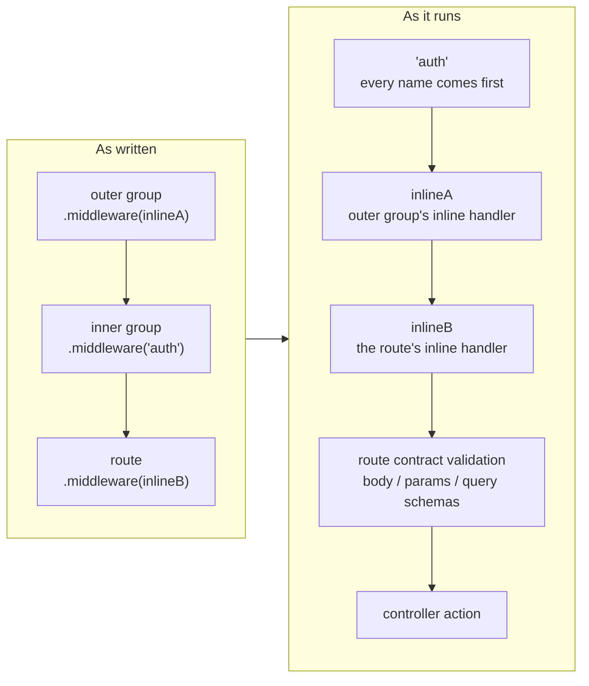

# Middleware Guide

Middleware runs code around a request: before the controller action, after it, or instead of it. Guren uses Hono's middleware model, and you attach middleware in one of three places:

| Where | Applies to | Section |
|-------|------------|---------|
| The application, with `app.use()` | Every request | [Global Middleware](#global-middleware) |
| A route or route group, with `.middleware()` | Those routes | [Route Middleware](#route-middleware) |
| A name, with `aliasMiddleware()` / `groupMiddleware()` | Routes that use the name | [Middleware Aliases](#middleware-aliases), [Middleware Groups](#middleware-groups) |

An app created with `createApp({ auth })` already mounts the session, CSRF and auth-context middleware for every request; see [Built-in Helpers](#built-in-helpers).

## Global Middleware

```ts
// src/app.ts
import { createApp, defineMiddleware } from '@guren/core'

const requestTimer = defineMiddleware(async (ctx, next) => {
  const started = performance.now()
  await next()
  const duration = Math.round(performance.now() - started)
  console.log(`${ctx.req.method} ${ctx.req.path} -> ${ctx.res.status} (${duration}ms)`)
})

const app = createApp()
app.use('*', requestTimer)
```

Global middleware has to be attached before the routes are mounted. A service provider therefore calls `app.use()` from `register()`, not `boot()`: routes are mounted between the two, and middleware added in `boot()` never runs for them. [Architecture](./architecture.md#service-providers) shows the provider form.

## Route Middleware

```ts
import { Router, requireAuthenticated } from '@guren/core'
import DashboardController from '@/app/Http/Controllers/DashboardController'

export function registerWebRoutes(router: Router): void {
  router.get('/dashboard', [DashboardController, 'index']).middleware(
    requireAuthenticated({ redirectTo: '/login' }),
  )
}
```

Route middleware applies only to that route, or to every route inside a group. `.middleware()` accepts handler functions, registered alias names, or a mix of both. Mixing the two changes the order they run in; see [Execution Order](#execution-order).

## Middleware Aliases

Register a short name for a middleware function, then refer to it by name in your route files without importing the function each time:

```ts
import { Router, requireAuthenticated } from '@guren/core'
import { requireAdmin } from '@/app/Http/middleware/admin'
import { csrfProtection } from '@/app/Http/middleware/csrf'

export function registerWebRoutes(baseRouter: Router): void {
  const router = baseRouter
    .aliasMiddleware('auth', requireAuthenticated())
    .aliasMiddleware('admin', requireAdmin())
    .aliasMiddleware('csrf', csrfProtection())
}
```

> [!IMPORTANT]
> `aliasMiddleware()` returns a **new `Router` type** carrying the alias name it just registered. Call it without capturing the result and the name never reaches the type, so a later `.middleware('auth')` fails to compile. Always chain and assign, as above.
>
> The type also travels across functions. See [Registering Aliases](./routing.md#registering-aliases).

Once registered, use the alias anywhere middleware is accepted:

```ts
router.get('/dashboard', [DashboardController, 'index']).middleware('auth')
router.post('/settings', [SettingsController, 'update']).middleware('auth', 'csrf')
```

Aliases also make middleware visible to `guren audit`, which reports a route's middleware by name. It recognizes the framework's guards (`requireAuthenticated()` and `requireGuest()`) either way, but any other middleware passed as a bare function is invisible to it.

## Middleware Groups

A group bundles several aliases under one name, for stacks that run together. Every member must already be a registered alias:

```ts
const router = new Router()
  .aliasMiddleware('auth', requireAuthenticated())
  .aliasMiddleware('session', createSessionMiddleware())
  .aliasMiddleware('csrf', createCsrfMiddleware())
  .aliasMiddleware('throttle', createRateLimitMiddleware({ limit: 60, windowMs: 60_000 }))
  .groupMiddleware('web', ['session', 'csrf'])
  .groupMiddleware('api', ['throttle'])
```

Apply a group to a set of routes with `router.middleware()`:

```ts
router.middleware('web').group((web) => {
  web.get('/', [HomeController, 'index'])
  web.get('/about', [PagesController, 'about'])
  web.get('/contact', [PagesController, 'contact'])
})

router.middleware('api').group((api) => {
  api.get('/api/posts', [ApiPostController, 'index'])
  api.post('/api/posts', [ApiPostController, 'store'])
})
```

Groups and individual aliases combine:

```ts
router.middleware('web', 'auth').group((group) => {
  group.get('/profile', [ProfileController, 'show'])
  group.put('/profile', [ProfileController, 'update'])
})
```

## Execution Order

A route's middleware runs in this order:

1. Every alias or group name in the route's chain, outer groups first.
2. Every inline handler function, outer groups first.
3. Validation of the route's `body`, `params` and `query` schemas.
4. The controller action.

Names run before functions across groups as well as within one `.middleware()` call. So an inline handler on an outer group runs *after* a name on an inner group, the reverse of how the code reads:



When relative order matters, register every piece as an alias. The last two steps cannot be reordered: a schema attached to the route is always validated after all middleware, immediately before the action.

## Built-in Helpers

| Helper | What it does | Mounted for you |
|--------|--------------|-----------------|
| `defineMiddleware` | Types a Hono middleware function for Guren | — |
| `createSessionMiddleware` | Attaches a session to each request | With `createApp({ auth })` |
| `createCsrfMiddleware` | Checks the CSRF token on state-changing requests | With `createApp({ auth })` |
| `attachAuthContext` | Puts the auth context on each request | Always |
| `requireAuthenticated` / `requireGuest` | Let only signed-in users / only guests through | No: add them to routes |
| `createRateLimitMiddleware` | Limits requests per client | No: add it to routes |

### `createSessionMiddleware`

Attaches a session to the request context. The session id travels in a signed cookie, and the data is kept in memory (`MemorySessionStore`) unless you pass a store. Mount it yourself only in an app without the `auth` option:

```ts
import { createSessionMiddleware } from '@guren/core'

app.use('*', createSessionMiddleware())
```

Read the session with `getSessionFromContext(ctx)` or `ctx.get('guren:session')`.

`store` accepts a `SessionStore` or a function returning one. The function runs on every request, so a store that needs a runtime binding (Workers) or a connection (Redis) is not built at boot; memoize it yourself if building is expensive. To declare several stores and pick one per environment, use a `SessionManager` (see [Authentication](./authentication.md#selecting-a-store-with-sessionmanager)).

### Auth Guards

`requireAuthenticated` and `requireGuest` read the auth context that the application attaches to every request, so you only add the guards:

```ts
import { Router, requireAuthenticated, requireGuest } from '@guren/core'

const router = new Router()
  .aliasMiddleware('auth', requireAuthenticated({ redirectTo: '/login' }))
  .aliasMiddleware('guest', requireGuest({ redirectTo: '/dashboard' }))

router.middleware('auth').group((auth) => {
  auth.get('/settings', [SettingsController, 'index'])
  auth.get('/dashboard', [DashboardController, 'index'])
})
```

`redirectTo` applies to browsers. An agent tool call (see the [Agent interface](./agent-interface.md)) cannot follow a redirect, so both guards answer it with a JSON refusal instead: `401` from `requireAuthenticated`, `403` from `requireGuest`, or the `status` you pass. A `responseFactory` set beside `redirectTo` is skipped for those calls too.

### CSRF Protection

The CSRF middleware checks the token on state-changing requests (POST, PUT, PATCH, DELETE). `createApp({ auth })` mounts it for every request, so add it by hand only in an app without the `auth` option:

```ts
const router = new Router().aliasMiddleware('csrf', createCsrfMiddleware())

router.middleware('csrf').group((csrf) => {
  csrf.post('/posts', [PostsController, 'store'])
})
```

[CSRF Protection](./csrf.md) covers tokens in forms and requests.

### Rate Limiting

Apply rate limiting to routes or groups:

```ts
import { createRateLimitMiddleware } from '@guren/core'

const router = new Router().aliasMiddleware('throttle', createRateLimitMiddleware({ limit: 60, windowMs: 60_000 }))

router.middleware('throttle').group((throttle) => {
  throttle.post('/api/login', [AuthController, 'login'])
})
```

[Rate Limiting](./rate-limiting.md) covers keys, stores and response headers.

## Writing Custom Middleware

Create middleware with `defineMiddleware`. The signed-in user is read through the auth context:

```ts
import { AUTH_CONTEXT_KEY, defineMiddleware } from '@guren/core'
import type { AuthContext } from '@guren/core'

export const requireSubscription = defineMiddleware(async (ctx, next) => {
  const auth = ctx.get(AUTH_CONTEXT_KEY) as AuthContext | undefined
  const user = await auth?.user<{ isSubscribed: boolean }>()

  if (!user?.isSubscribed) {
    return ctx.json({ error: 'Subscription required' }, 403)
  }

  await next()
})
```

Save it under `app/Http/middleware/` and register it as an alias to use it by name:

```ts
import { Router } from '@guren/core'
import { requireSubscription } from '@/app/Http/middleware/subscription'

const router = new Router().aliasMiddleware('subscribed', requireSubscription)

router.middleware('subscribed').group((group) => {
  group.get('/premium', [PremiumController, 'index'])
})
```
