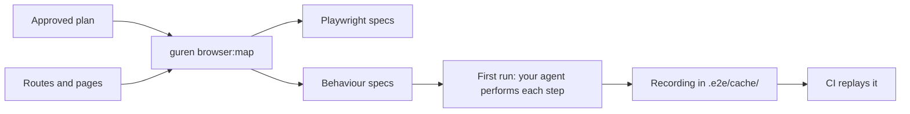

# ブラウザテスト

`bunx guren add browser-tests` を実行すると、アプリを本物のブラウザで開くテストが導入されます。spec は Guren が生成します。もとになるのは、ルートとそれが描画するページ、そして承認済みの[実装計画](./implementation-plans.md)にあるビューと振る舞いです。アプリや計画が変わったときは `bunx guren browser:map` が書き直すので、spec を手で追従させる必要はありません。

テストは 2 層に分かれています。Playwright の spec では、各ページが描画され、計画どおりの内容を表示しているかを確かめます。振る舞いの spec では、計画の振る舞いを実際に実行し、フォームの入力と送信から遷移先のページの確認までを行います。ステップは、初回だけコーディングエージェントが実行します。ランナーがその操作を記録しておくので、CI ではモデルもログインも使わずに記録を再生します。



## spec が確かめること

| spec | テストの単位 | 確かめること |
|------|--------------|--------------|
| `tests/browser/generated/smoke.browser.ts` | ブラウザマップの機能ごと | パスパラメーターのない最初のページが 200 を返し、ルートが描画するはずのコンポーネントを表示する |
| `tests/browser/generated/plans/<plan>.browser.ts` | 承認済みの計画のビューごと | 計画がビューに定めたフォームのラベルとアクション名が、すべてページに表示されている |
| `tests/browser/generated/a11y.browser.ts` | 上の 2 つが開くページごと | axe が WCAG 2.0 から 2.2 の A と AA の違反を見つけない |
| `tests/browser/behaviours/generated/<plan>.e2e.ts` | 承認済みの計画の振る舞いごと | 振る舞いを実行した結果が計画どおりになる。リダイレクト先、遷移先のページのラベルとアクション、計画がエラーを見込むフィールドの `aria-invalid` を見る |

ブラウザに現れないものは、引き続き `TestApp` で確かめます。ステータスコード、データベースの行、未サインインのユーザーや権限のないユーザーへの応答などです。詳しくは[テストガイド](./testing.md)を読んでください。

## Playwright の spec を導入する

```bash
bunx guren add browser-tests
bunx playwright install chromium
bun run test:browser
```

1 つ目のコマンドを実行すると、`playwright.browser.config.ts` と `tests/browser/support.ts` が書き出され、`test:browser` スクリプトが追加されます。devDependency には `@playwright/test` と `@axe-core/playwright` が加わります。最後に `bunx guren browser:map` が 1 回実行され、spec が書き出されます。Playwright は Node 上で動くので、`PATH` に Node 20.12 以降が必要です。

設定ファイルは、アプリを `bunx guren browser:serve` 経由で `127.0.0.1:4317` に起動します。`browser:serve` は、`NODE_ENV=production` のときと、ローカルだと確かめられないデータベースに対しては起動しません。そのため、テストの実行が本番のデータに届くことはありません。

パスワードでサインインするアプリ(`bunx guren add auth` が書き出す `users` テーブルと `POST /login` ルートがあるアプリ)では、サインインのセットアップと、アカウントを 1 つ作るシーダーも書き出されます。アカウントは `browser@example.test` です。初回の実行までに、`.env` でパスワードを設定してください。

```bash
BROWSER_TEST_PASSWORD=choose-a-password
```

シーダーは、`browser:serve` がアプリを起動したときにだけアカウントを作ります。それ以外の起動や本番環境では何もしません。

spec が開けないページは、理由を書いた `test.fixme` になります。どのルートもパスパラメーターを取る、まだ描画するルートがない、アプリが用意できないサインイン済みのユーザーが要る、といった場合です。結果ではスキップとして表示され、合格にはなりません。アクセシビリティの確認から axe のルールやページの一部を外すときは、`tests/browser/a11y.ts` を編集します。このファイルは利用者が編集するファイルで、生成では書き換えられません。

## spec を最新に保つ

計画を承認したとき、ルートを足したとき、ページを移したときは、`bunx guren browser:map` をもう一度実行します。生成した spec が書き直され、どの機能や計画からも生成されなくなった spec は削除されます。

```bash
bunx guren browser:map          # ブラウザマップと生成した spec を書き直す
bunx guren browser:map --check  # 何も書かず、生成した spec が古いあいだは終了コード 1 を返す
```

`--check` は CI に向いています。ページを変えたのに spec を生成し直していないプルリクエストは、そこで失敗します。`generated/` ディレクトリに生成ヘッダーのないファイルがあると、`browser:map` は上書きを拒みます。自分で書く spec は、このディレクトリの外に置いてください。

ブラウザテストは `guren gate` では実行されません。CI では別のステップとして実行してください。

## 計画の振る舞いを実行する

計画の受け入れ振る舞いには、アプリの動きが書かれています。たとえば「サインイン済みのユーザーが投稿を作ると、その投稿のページに移る」「空白だけのタイトルは拒否される」といった内容です。これをブラウザで実行するには、`--behaviours` を付け、どのコーディングエージェントのログインでステップを実行するかを指定します。

```bash
bunx guren add browser-tests --behaviours --agent claude-code
```

`--agent` には `claude-code`、`codex`、`none` のどれかを指定します。既定値はありません。以後は `browser:map` が、振る舞いごとに 1 つのテストを `tests/browser/behaviours/generated/<plan>.e2e.ts` にも保ちます。生成されるテストは次のような形です。

```ts
test('AC-posts-store-1 (b07536): a signed-in user creates a post', { session: 'browser' }, async ({ app, agent, screen, browser }) => {
  const start = await begin('AC-posts-store-1', undefined, { app, browser })
  await browser.goto('/posts/create', { waitUntil: 'networkidle' })
  await expectDefaultLocale(browser)
  const off = await browser.onDialog('accept')
  await agent.act('set "Title" to {title}, then submit the form', { params: { title: 'Measured post' } })
  await off()
  await expect(browser).toHaveURL(landed(['/posts/', { not: ['create'] }], start))
  await expect(screen.getByRole('button', 'Edit').or(screen.getByRole('link', 'Edit')).first()).toBeVisible()
  await expect(screen.getByRole('button', 'Delete').or(screen.getByRole('link', 'Delete')).first()).toBeVisible()
})
```

テストは振る舞いの開始ページを開き、通信が落ち着いてハイドレーションが済むのを待ってから、振る舞いを実行します。エージェントには、計画から組み立てた指示を 1 つだけ渡し、そのステップの操作だけを任せます。そのあとの確認はすべて通常のロケーターで行い、ブラウザが着地した URL と、計画が遷移先のページに定めたラベルとアクションを確かめます。テストが通ったかどうかをモデルが判定することはありません。

振る舞いが触る操作がすべて計画に書かれている場合は、ステップもロケーターで書かれるので、エージェントは要りません。入力がどれもフォームのラベル付きのフィールドで、ルートを送るアクションの名前も計画にある場合です。

種類が `success` か `validation` で、ルートが `GET` 以外の振る舞いがテストになります。ただし、計画のビューがそのルートへフォームを送信するか、そのルートのアクションを持っている場合に限ります。それ以外の振る舞いはスキップされるテストになり、タイトルに理由が入ります。そのため、ファイルには振る舞いごとに 1 つのテストが並びます。

開始ページがパスパラメーターを取る振る舞い(`/posts/:id/edit`)では、開くレコードが必要です。`tests/browser/behaviours/given.ts` にエントリーを書いて用意します。このファイルも利用者が編集するファイルです。

```ts
export const given: Record<string, (fixtures: GivenFixtures) => Promise<Record<string, string> | void>> = {
  'AC-posts-update-1': async ({ browser }) => {
    await browser.goto('/posts/create', { waitUntil: 'networkidle' })
    await browser.locator('input[name="title"]').fill('Given post')
    await browser.locator('button[type="submit"]').tap()
    await browser.waitForURL(/\/posts\/\d+$/u)
    return { id: new URL(await browser.url()).pathname.split('/').at(-1)! }
  },
}
```

## 一度記録して、CI では再生する

振る舞いの spec は [e2e](https://github.com/e2e-inc/e2e) ランナーで動きます。エージェントの操作は、ステップごとに `.e2e/cache/` へ記録されます。実行には 2 つのスクリプトを使います。

```bash
bun run test:behaviours       # 記録のあるステップは再生し、残りはモデルで実行して記録する
bun run test:behaviours:ci    # 再生だけを行う(--strict-cache)
```

計画を承認したあとやページを変えたあとに、手元で `bun run test:behaviours` を実行し、`.e2e/cache/` をコミットしてください。記録はテストデータなので、その差分はページを変えたコミットに含めます。CI では `bun run test:behaviours:ci` を実行します。ログインも API キーも要りません。

小さなアプリで計測したところ、モデルでの実行は 1 ステップあたり、Claude Code(`sonnet`)で約 10 秒、4 万 1 千トークンでした。トークンの 85% 以上はキャッシュの読み出しです。記録のあるステップはモデルを呼ばずに再生されます。エージェントのログインは、ステップを初めて実行するときと、ページが変わって記録が合わなくなったときにだけ使われます。Claude Code で作った記録は Codex でも再生され、逆も同じです。

記録は空のデータベースに対して作ってください。CI は空のデータベースから始まるためです。この実行に専用のデータベースを持たせる方法は、[CLI リファレンス](./cli.md#振る舞いの-spec)にあります。

## ページを変えたとき

記録には、ステップの操作と、ステップが終わった時点でページに表示されていた内容が入っています。ステップが押すボタンの名前を変えると、CI での再生はモデルを呼ばずに `REPLAY_STALE` で失敗します。何が起きたかは、`bun run test:behaviours:ci` の終了コードで分かります。

| 終了コード | 意味 | 対応 |
|------------|------|------|
| 0 | すべてのステップを再生した | 不要 |
| 1 | ステップのあとの確認が通らなかった | ページの動きが計画と違っています。ページか計画を直します |
| 2 | `REPLAY_STALE`(記録がいまのページに合わない) | 手元で `bun run test:behaviours` を実行します。通ったら新しい記録をコミットします。失敗するなら、ページの動きが計画と違っています |
| 3 | 記録のないステップがあり、CI にはそれを実行するログインがない。アプリを起動できなかったときも同じコードになる | 手元で `bun run test:behaviours` を実行し、記録をコミットします |

実行が失敗したあとは、ページか計画を直すまで `.e2e/cache/` をコミットしないでください。終了コードの全体は、[CLI リファレンス](./cli.md#振る舞いの-spec)の表にあります。

## エージェントに渡るもの

エージェントにはステップ用のツールだけが渡され、シェルもファイルも MCP サーバーも使えません。env ファイルに書かれた変数は、`BROWSER_TEST_PASSWORD` も含めて、設定ファイルがすべて空文字にしてエージェントへ渡します。パスワードはランナーが入力するので、エージェントには渡りません。

シェルだけで `export` している変数はエージェントに届きます。テストを実行するシェルでは、秘密の値を `export` しないでください。

## エージェントを使わない場合

`--agent none` を指定すると、エージェントなしでランナーを導入します。

```bash
bunx guren add browser-tests --behaviours --agent none
```

触る操作がすべて計画に書かれた振る舞いはロケーターで実行されるので、ログインも記録も要りません。agent のステップが必要な振る舞いは、その理由を書いたスキップのテストになります。あとからエージェントを足すときは、`--agent claude-code --force` を付けてもう一度実行してください。設定ファイルは書き直され、`given.ts` と記録はそのまま残ります。

## 次のステップ

- CLI リファレンスの [`add browser-tests`](./cli.md#add-browser-tests) と[振る舞いの spec](./cli.md#振る舞いの-spec): コマンドが書き出すファイルとオプションの一覧
- [実装計画](./implementation-plans.md): spec のもとになる計画の書き方と進め方
- [テストガイド](./testing.md): ブラウザに現れないものを確かめる `TestApp`
