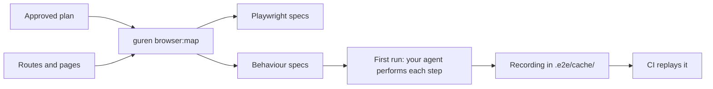

# ブラウザテスト

`bunx guren add browser-tests` を実行すると、アプリを本物のブラウザで開くテストが導入されます。spec は Guren が生成します。もとになるのは、ルートとそれが描画するページ、そして承認済みの[実装計画](./implementation-plans.md)にあるビューと振る舞いです。アプリや計画が変わったときは `bunx guren browser:map` が書き直すので、spec を手で追従させる必要はありません。

テストは 2 層に分かれています。Playwright の spec では、各ページが描画され、計画どおりの内容を表示しているかを確かめます。振る舞いの spec では、計画の振る舞いを実際に実行し、フォームの入力と送信から遷移先のページの確認までを行います。ステップは、初回だけコーディングエージェントが実行します。ランナーがその操作を記録しておくので、CI ではモデルもログインも使わずに記録を再生します。



## spec が確かめること

| spec | テストの単位 | 確かめること |
|------|--------------|--------------|
| `tests/browser/generated/smoke.browser.ts` | ブラウザマップの機能ごと | パスパラメーターのない最初のページが 200 を返し、ルートが描画するはずのコンポーネントを表示する |
| `tests/browser/generated/plans/<plan>.browser.ts` | 承認済みの計画のビューごと | 計画がビューに定めたフォームのラベルとアクション名が、すべてページに表示されている |
| `tests/browser/generated/a11y.browser.ts` | 上の 2 つが開くページごと | axe が WCAG 2.0 から 2.2 の A と AA の違反を見つけない |
| `tests/browser/behaviours/generated/<plan>.e2e.ts` | 承認済みの計画の振る舞いごと | 振る舞いを実行した結果が計画どおりになる。リダイレクト先、遷移先のページのラベルとアクション、計画がエラーを見込むフィールドの `aria-invalid` を見る |

ブラウザに現れないものは、引き続き `TestApp` で確かめます。ステータスコード、データベースの行、未サインインのユーザーや権限のないユーザーへの応答などです。詳しくは[テストガイド](./testing.md)を読んでください。

## Playwright の spec を導入する

```bash
bunx guren add browser-tests
bunx playwright install chromium
bun run test:browser
```

1 つ目のコマンドを実行すると、`playwright.browser.config.ts` と `tests/browser/support.ts` が書き出され、`test:browser` スクリプトが追加されます。devDependency には `@playwright/test` と `@axe-core/playwright` が加わります。最後に `bunx guren browser:map` が 1 回実行され、spec が書き出されます。Playwright は Node 上で動くので、`PATH` に Node 20.12 以降が必要です。

設定ファイルは、アプリを `bunx guren browser:serve` 経由で `127.0.0.1:4317` に起動します。`browser:serve` は、`NODE_ENV=production` のときと、ローカルだと確かめられないデータベースに対しては起動しません。そのため、テストの実行が本番のデータに届くことはありません。

パスワードでサインインするアプリ(`bunx guren add auth` が書き出す `users` テーブルと `POST /login` ルートがあるアプリ)では、サインインのセットアップと、アカウントを 1 つ作るシーダーも書き出されます。アカウントは `browser@example.test` です。初回の実行までに、`.env` でパスワードを設定してください。

```bash
BROWSER_TEST_PASSWORD=choose-a-password
```

シーダーは、`browser:serve` がアプリを起動したときにだけアカウントを作ります。それ以外の起動や本番環境では何もしません。

spec が開けないページは、理由を書いた `test.fixme` になります。どのルートもパスパラメーターを取る、まだ描画するルートがない、アプリが用意できないサインイン済みのユーザーが要る、といった場合です。結果ではスキップとして表示され、合格にはなりません。アクセシビリティの確認から axe のルールやページの一部を外すときは、`tests/browser/a11y.ts` を編集します。このファイルは利用者が編集するファイルで、生成では書き換えられません。

## spec を最新に保つ

計画を承認したとき、ルートを足したとき、ページを移したときは、`bunx guren browser:map` をもう一度実行します。生成した spec が書き直され、どの機能や計画からも生成されなくなった spec は削除されます。

```bash
bunx guren browser:map          # ブラウザマップと生成した spec を書き直す
bunx guren browser:map --check  # 何も書かず、生成した spec が古いあいだは終了コード 1 を返す
```

`--check` は CI に向いています。ページを変えたのに spec を生成し直していないプルリクエストは、そこで失敗します。`generated/` ディレクトリに生成ヘッダーのないファイルがあると、`browser:map` は上書きを拒みます。自分で書く spec は、このディレクトリの外に置いてください。

ブラウザテストは `guren gate` では実行されません。CI では別のステップとして実行してください。

## 計画の振る舞いを実行する

計画の受け入れ振る舞いには、アプリの動きが書かれています。たとえば「サインイン済みのユーザーが投稿を作ると、その投稿のページに移る」「空白だけのタイトルは拒否される」といった内容です。これをブラウザで実行するには、`--behaviours` を付け、どのコーディングエージェントのログインでステップを実行するかを指定します。

```bash
bunx guren add browser-tests --behaviours --agent claude-code
```

`--agent` には `claude-code`、`codex`、`none` のどれかを指定します。既定値はありません。以後は `browser:map` が、振る舞いごとに 1 つのテストを `tests/browser/behaviours/generated/<plan>.e2e.ts` にも保ちます。生成されるテストは次のような形です。

```ts
test('AC-posts-store-1 (b07536): a signed-in user creates a post', { session: 'browser' }, async ({ app, agent, screen, browser }) => {
  const start = await begin('AC-posts-store-1', undefined, { app, browser })
  await browser.goto('/posts/create', { waitUntil: 'networkidle' })
  await expectDefaultLocale(browser)
  const off = await browser.onDialog('accept')
  await agent.act('set "Title" to {title}, then submit the form', { params: { title: 'Measured post' } })
  await off()
  await expect(browser).toHaveURL(landed(['/posts/', { not: ['create'] }], start))
  await expect(screen.getByRole('button', 'Edit').or(screen.getByRole('link', 'Edit')).first()).toBeVisible()
  await expect(screen.getByRole('button', 'Delete').or(screen.getByRole('link', 'Delete')).first()).toBeVisible()
})
```

テストは振る舞いの開始ページを開き、通信が落ち着いてハイドレーションが済むのを待ってから、振る舞いを実行します。エージェントには、計画から組み立てた指示を 1 つだけ渡し、そのステップの操作だけを任せます。そのあとの確認はすべて通常のロケーターで行い、ブラウザが着地した URL と、計画が遷移先のページに定めたラベルとアクションを確かめます。テストが通ったかどうかをモデルが判定することはありません。

振る舞いが触る操作がすべて計画に書かれている場合は、ステップもロケーターで書かれるので、エージェントは要りません。入力がどれもフォームのラベル付きのフィールドで、ルートを送るアクションの名前も計画にある場合です。

種類が `success` か `validation` で、ルートが `GET` 以外の振る舞いがテストになります。ただし、計画のビューがそのルートへフォームを送信するか、そのルートのアクションを持っている場合に限ります。それ以外の振る舞いはスキップされるテストになり、タイトルに理由が入ります。そのため、ファイルには振る舞いごとに 1 つのテストが並びます。

開始ページがパスパラメーターを取る振る舞い(`/posts/:id/edit`)では、開くレコードが必要です。`tests/browser/behaviours/given.ts` にエントリーを書いて用意します。このファイルも利用者が編集するファイルです。

```ts
export const given: Record<string, (fixtures: GivenFixtures) => Promise<Record<string, string> | void>> = {
  'AC-posts-update-1': async ({ browser }) => {
    await browser.goto('/posts/create', { waitUntil: 'networkidle' })
    await browser.locator('input[name="title"]').fill('Given post')
    await browser.locator('button[type="submit"]').tap()
    await browser.waitForURL(/\/posts\/\d+$/u)
    return { id: new URL(await browser.url()).pathname.split('/').at(-1)! }
  },
}
```

## 一度記録して、CI では再生する

振る舞いの spec は [e2e](https://github.com/e2e-inc/e2e) ランナーで動きます。エージェントの操作は、ステップごとに `.e2e/cache/` へ記録されます。実行には 2 つのスクリプトを使います。

```bash
bun run test:behaviours       # 記録のあるステップは再生し、残りはモデルで実行して記録する
bun run test:behaviours:ci    # 再生だけを行う(--strict-cache)
```

計画を承認したあとやページを変えたあとに、手元で `bun run test:behaviours` を実行し、`.e2e/cache/` をコミットしてください。記録はテストデータなので、その差分はページを変えたコミットに含めます。CI では `bun run test:behaviours:ci` を実行します。ログインも API キーも要りません。

小さなアプリで計測したところ、モデルでの実行は 1 ステップあたり、Claude Code(`sonnet`)で約 10 秒、4 万 1 千トークンでした。トークンの 85% 以上はキャッシュの読み出しです。記録のあるステップはモデルを呼ばずに再生されます。エージェントのログインは、ステップを初めて実行するときと、ページが変わって記録が合わなくなったときにだけ使われます。Claude Code で作った記録は Codex でも再生され、逆も同じです。

記録は空のデータベースに対して作ってください。CI は空のデータベースから始まるためです。この実行に専用のデータベースを持たせる方法は、[後半のリファレンス](#リファレンス-振る舞いの-spec)にあります。

## ページを変えたとき

記録には、ステップの操作と、ステップが終わった時点でページに表示されていた内容が入っています。ステップが押すボタンの名前を変えると、CI での再生はモデルを呼ばずに `REPLAY_STALE` で失敗します。何が起きたかは、`bun run test:behaviours:ci` の終了コードで分かります。

| 終了コード | 意味 | 対応 |
|------------|------|------|
| 0 | すべてのステップを再生した | 不要 |
| 1 | ステップのあとの確認が通らなかった | ページの動きが計画と違っています。ページか計画を直します |
| 2 | `REPLAY_STALE`(記録がいまのページに合わない) | 手元で `bun run test:behaviours` を実行します。通ったら新しい記録をコミットします。失敗するなら、ページの動きが計画と違っています |
| 3 | 記録のないステップがあり、CI にはそれを実行するログインがない。アプリを起動できなかったときも同じコードになる | 手元で `bun run test:behaviours` を実行し、記録をコミットします |

実行が失敗したあとは、ページか計画を直すまで `.e2e/cache/` をコミットしないでください。終了コードの全体は、[後半のリファレンス](#リファレンス-振る舞いの-spec)の表にあります。

## エージェントに渡るもの

エージェントにはステップ用のツールだけが渡され、シェルもファイルも MCP サーバーも使えません。env ファイルに書かれた変数は、`BROWSER_TEST_PASSWORD` も含めて、設定ファイルがすべて空文字にしてエージェントへ渡します。パスワードはランナーが入力するので、エージェントには渡りません。

シェルだけで `export` している変数はエージェントに届きます。テストを実行するシェルでは、秘密の値を `export` しないでください。

## エージェントを使わない場合

`--agent none` を指定すると、エージェントなしでランナーを導入します。

```bash
bunx guren add browser-tests --behaviours --agent none
```

触る操作がすべて計画に書かれた振る舞いはロケーターで実行されるので、ログインも記録も要りません。agent のステップが必要な振る舞いは、その理由を書いたスキップのテストになります。あとからエージェントを足すときは、`--agent claude-code --force` を付けてもう一度実行してください。設定ファイルは書き直され、`given.ts` と記録はそのまま残ります。

## リファレンス: `add browser-tests`

コマンドが書き出すファイルとオプションの一覧です。ここまでの説明で足りないところを確かめるときに使ってください。

`add browser-tests` は、Playwright のブラウザテストを導入します。テストはアプリを `bunx guren browser:serve` 経由で起動するので、本番環境や、ローカルだと確かめられないデータベースでは起動しません。このコマンドは `playwright.browser.config.ts`(アプリを `127.0.0.1:4317` で、その Vite dev サーバーをポート 4318 から起動する設定)と `tests/browser/support.ts` を書き出してから `bunx guren browser:map` を実行します。Vite のポートは、`GUREN_VITE_PORT` を設定していなければ `browser:serve` がアプリのポートの次の番号にします。以後は `browser:map` が、`tests/browser/generated/` の下に次の 2 種類の spec を保ちます。

- `smoke.browser.ts`: ブラウザマップの機能ごとに 1 つのテストで、パスパラメーターのない最初のページが 200 を返し、ルートが描画するはずのコンポーネントを表示することを確かめます
- `plans/<plan>.browser.ts`: ビューを持つ承認済みの計画ごとに 1 つのファイルで、計画がビューに定めたフォームのラベルとアクション名が、そのビューを描画するパスパラメーターのない最初のページに表示されることを確かめます

計画のラベルはアプリの既定ロケールで書かれるので、設定ファイルは Playwright の `locale` をその既定ロケールにします。既定ロケールは `createApp({ i18n })` から読み取ります(`fallback`、なければ `supported` の先頭で、読み取れなければ警告を出して `en`)。設定しないと、サーバーはブラウザの `Accept-Language` からロケールを選んでしまいます。セットアッププロジェクトはサインイン済みのセッションを保存する前に `locale` cookie を消します。各計画の spec はラベルを探す前に、ページの `_i18n.locale` が `_i18n.fallbackLocale` と一致するかを確かめます。別のロケールで描画されたページでは、直すべき設定の行を示すメッセージで spec が失敗するので、ラベルが見つからない理由をすぐに見分けられます。アプリの既定ロケールを変えたときは、`playwright.browser.config.ts` の `LOCALE` も変えてください。

開けないページ(どのルートもパラメーターを取る、まだ描画するルートがない、アプリが用意できないサインイン済みのユーザーが要る)は、理由を書いた `test.fixme` になります。結果ではスキップとして表示され、合格にはなりません。計画を承認したら `bunx guren browser:map` をもう一度実行してください。生成した spec が古いあいだ、`--check` は終了コード 1 を返します。どの機能や計画からも生成されなくなった spec は削除されます。生成ヘッダーのないファイルが `tests/browser/generated/` にあると上書きを拒むので、自分で書く spec はこのディレクトリの外に置いてください。

パスワードでサインインするアプリ(`make:auth` が書き出す `users` テーブルと `POST /login` ルートがあるアプリ)では、セットアッププロジェクトの `tests/browser/auth.setup.ts` と、シーダーの `db/seeders/browser-account.ts` も書き出します。シーダーは `browser:serve` がアプリを起動したときに `BROWSER_TEST_PASSWORD` のパスワードで `browser@example.test` を作り、それ以外の起動や本番環境では何もしません。初回の実行までに `.env` の `BROWSER_TEST_PASSWORD` を設定してください。シーダーは起動時のシードで動くので、`config/database.ts` で `defineDatabaseConfig()` に `seedOnBoot` を渡しておく必要があります。渡していなければ、コマンドが警告します。

あわせて `test:browser` スクリプト(`playwright test -c playwright.browser.config.ts`)を追加し、`@playwright/test` を devDependency に加えます。`--no-install` を付けると、`bun add` のコマンドを表示するだけになります。`test-results/`、`playwright-report/`、`tests/browser/.auth/` は `.gitignore` に追加されます。別のコマンドを実行する `test:browser` スクリプトがすでにあれば、何も書かずに中断します(`--force` で置き換えます)。`bunx playwright install chromium` でブラウザを入れてから、`bun run test:browser` で実行します。Playwright は Node 上で動くので、`PATH` に Node 20.12 以降が必要です。

`bun test` は `*.spec.ts` も集めてしまうため、spec のファイル名は `.browser.ts` で終わります。ブラウザテストは `guren gate` では実行されません。

## リファレンス: 振る舞いの spec

`add browser-tests --behaviours --agent claude-code` は、承認済みの計画の振る舞いをブラウザで実行するテストを導入します。テストは振る舞いの開始ページを開き、通信が落ち着いてハイドレーションが済むのを待ってから、振る舞いを実行します。触る操作がすべて計画に書かれている場合は、ロケーターで入力して実行するので、モデルは呼びません。具体的には、入力がどれもフォームのラベル付きのテキスト・数値・チェックボックス・セレクトのフィールドで、ルートを送るアクションの名前も計画にある場合です。それ以外の場合は、計画から組み立てた指示(`set "Title" to {title}, then submit the form`)を 1 つコーディングエージェントに渡して操作させます。どちらの場合も、結果は通常のロケーターで確かめます。確かめる対象は、リダイレクト先、遷移先のページのラベルとアクション、計画がエラーを見込むフィールドの `aria-invalid` です。テストは [e2e](https://github.com/e2e-inc/e2e) ランナーで動き、エージェントの操作はステップごとに記録されます。記録のあるステップはモデルを呼ばずに再生されます。エージェントのログインは、ステップを初めて実行するときと、ページが変わって記録が合わなくなったときにだけ使われます。

`--agent` は必須で、既定値はありません。どのエージェントのログインでステップを実行するかを、`claude-code` か `codex` で指定します。一方のエージェントで作った記録は、もう一方でも再生されます。`--agent none` を指定すると、エージェントなしでランナーを導入します。インストールされるのは `e2e` と `@e2e-dev/web` だけです。触る操作がすべて計画に書かれた振る舞いはロケーターで実行されるので、ログインも記録も要りません。agent のステップが必要な振る舞いは、その理由を書いた skip のテストになります。あとからエージェントを変えるときは、`--force` を付けてもう一度実行してください。設定ファイルは書き直され、`given.ts` と記録はそのまま残ります。この方法で `--agent none` に切り替えると、`@e2e-dev/acp` とエージェントのアダプターも削除します(`--no-install` を付けると、代わりに `bun remove` のコマンドを表示します)。`browser:map` が agent のステップを書くのは、`e2e.browser.config.ts` が `@e2e-dev/acp` から executor を import していて、アプリがそのパッケージを依存に持つときだけです。コマンドは次のファイルを一度だけ書き出します。

- `e2e.browser.config.ts`: アプリを `bunx guren browser:serve` 経由で `127.0.0.1:4319` に起動する設定です。すでに動いているサーバーには接続しません
- `tests/browser/behaviours/given.ts`: 利用者が編集するファイルです(後述)
- `tests/browser/behaviours/auth.setup.e2e.ts`: パスワードでサインインするアプリでだけ書き出します。Playwright のセットアップと同じシード済みのアカウントでサインインし、テストが使うセッションを保存します

あわせて `test:behaviours` と `test:behaviours:ci` のスクリプトを追加し、`e2e`、`@e2e-dev/web`、`@e2e-dev/acp` を固定のバージョンで、選んだエージェント用のアダプターと一緒にインストールします。`--no-install` を付けると、`bun add` のコマンドを表示するだけになります。`.gitignore` には `.e2e/*` と `!.e2e/cache/` が追加されます。以後は `bunx guren browser:map` が、振る舞いごとに 1 つのテストを `tests/browser/behaviours/generated/<plan>.e2e.ts` に保ちます。

種類が `success` か `validation` で、ルートが `GET` 以外の振る舞いがテストになります。ただし、計画のビューがそのルートへフォームを送信するか、そのルートのアクションを持っている場合に限ります。それ以外の振る舞いはスキップされるテストになり、タイトルに理由が入ります。たとえば、`TestApp` でしか確かめられない種類(未サインイン、権限のないユーザー、存在しないレコード)、実行後にブラウザで確かめられるものが残らない振る舞い、フォームのコントロールがリクエストの前に止めてしまう入力値です。開始ページがパスパラメーターを取る振る舞い(`/posts/:id/edit`)には、`given.ts` のエントリーが必要です。エントリーではレコードを作り、パラメーターの値を返します。エントリーがないテストは実行時にスキップされ、足りないエントリーが理由に示されます。

```ts
export const given: Record<string, (fixtures: GivenFixtures) => Promise<Record<string, string> | void>> = {
  'AC-posts-update-1': async ({ browser }) => {
    await browser.goto('/posts/create', { waitUntil: 'networkidle' })
    await browser.locator('input[name="title"]').fill('Given post')
    await browser.locator('button[type="submit"]').tap()
    await browser.waitForURL(/\/posts\/\d+$/u)
    return { id: new URL(await browser.url()).pathname.split('/').at(-1)! }
  },
}
```

実行には 2 つのスクリプトを使います。

```bash
bun run test:behaviours       # 記録のあるステップは再生し、残りはモデルで実行して記録する
bun run test:behaviours:ci    # 再生だけを行う(--strict-cache)
```

計画を承認したあとやページを変えたあとに `bun run test:behaviours` を実行し、`.e2e/cache/` をコミットしてください。記録はテストデータなので、その差分はページを変えたコミットに含めます。小さなアプリで計測したところ、モデルでの実行は 1 ステップあたり、Claude Code(`sonnet`)で約 10 秒、4 万 1 千トークン、Codex で約 17 秒、6 万 5 千トークンでした。どちらもトークンの 85% 以上はキャッシュの読み出しです。記録済みのテスト 4 件の再生は 7 秒でした。初回の実行では、ランナーが固定している Chromium が、Playwright のものとは別にダウンロードされます。

`browser:map` がテストを作り直すとタイトルが変わり、新しいタイトルで記録し直されます。古い記録は `.e2e/cache/` に残ります。ランナーには、なくなったテストの記録だけを消すコマンドがないためです。古い記録を消すときは、`bunx e2e cache clear` を実行してから `bun run test:behaviours` を実行します。agent のステップはすべてモデルでもう一度実行され、記録されます。ロケーターで実行するテストには記録がないので、古い記録も残りません。

記録は空のデータベースに対して作ってください。CI は空のデータベースから始まるためです。記録には、ステップが終わった時点でページに表示されていた内容も含まれます。以前の実行の行が一覧に残った状態で作った記録は、空のデータベースでは合わなくなりました(`REPLAY_STALE`)。空のデータベースで作った記録は、どちらの状態でも再生されました。開発用のデータベースを使わずに済ませるには、専用のデータベースを用意します。`e2e.browser.config.ts` の `args` に `'--database-url', './data/behaviours.db'`(ほかのローカルのデータベースの URL でも構いません)を足し、`DATABASE_URL=./data/behaviours.db bunx guren db:migrate` でマイグレーションを適用してください。記録を作る前には、そのデータベースを削除してマイグレーションをやり直します。

CI では `bun run test:behaviours:ci` を実行します。ログインも API キーも要りません。macOS で作った記録は Linux でも再生されます(Debian のコンテナで計測)。最小構成の Linux イメージでは、先に `bunx playwright-core install-deps chromium` で Chromium のシステムライブラリを入れてください。入っていないとブラウザが起動せず、終了コード 3 で終わります。何が起きたかは終了コードで分かります。

| 終了コード | 意味 | 対応 |
|------------|------|------|
| 0 | すべてのステップを再生した | 不要 |
| 1 | テストが失敗した | ステップのあとの確認が通っていません。ページの動きが計画と違っています |
| 2 | `REPLAY_STALE`(記録がいまのページに合わない) | 手元で `bun run test:behaviours` を実行します。通ったら新しい記録をコミットします。失敗するなら、ページの動きが計画と違っています。失敗した実行は合わなくなった記録を削除するので、ページか計画を直すまで `.e2e/cache/` はコミットしないでください |
| 2 | `MODEL_UNAVAILABLE`(agent のステップを持つテストがあるのに、設定ファイルにエージェントがない) | `bunx guren browser:map` を実行します。`e2e.browser.config.ts` が `@e2e-dev/acp` から executor を import していなければ、その振る舞いは skip のテストとして書き直されます。import は残っていて `agents` だけがない場合は、`bunx guren add browser-tests --behaviours --agent <agent> --force` でエージェントを指定し直すか、`--agent none --force` で取り除いてください |
| 3 | ステップを実行できなかった | 記録のないステップがモデルを呼ぼうとして、ログインがないために失敗しています(`MODEL_PROVIDER_FAILED`)。手元で `bun run test:behaviours` を実行し、記録をコミットしてください。計画が変わって `browser:map` が作り直したテストはタイトルが変わるので、まだ記録がありません。アプリを起動できなかったときも同じコードになります |

エージェントにはステップ用のツールだけが渡され、シェルもファイルも MCP サーバーも使えません。生成される形のステップを、Claude Code で 65 回、Codex で 52 回モデルに実行させた計測では、エージェントが自前のツールを使おうとして拒否される `POLICY_DENIED` は 1 度も起きませんでした(95% の信頼度で発生率はそれぞれ 4.6% 未満、5.8% 未満)。env ファイルに書かれた変数は、`BROWSER_TEST_PASSWORD` も含めて、設定ファイルがすべて空文字にしてエージェントへ渡します。そうしないと、Bun が env ファイルをエージェントのプロセスにも読み込むためです。`.env` に `ANTHROPIC_API_KEY` や `OPENAI_API_KEY` があっても同じように空になり、エージェントは自身のログインで動きました。パスワードはランナーが入力するので、エージェントには渡りません。シェルだけで `export` している変数はエージェントに届くので、テストを実行するシェルでは秘密の値を `export` しないでください。起動したあとのエージェントのプロセスが何を読むかまでは確かめていません。

`BROWSER_TEST_PASSWORD` が未設定のときは、サインインのセットアップが変数名を示して失敗し、サインインが必要なテストはスキップされます。`--force` は設定ファイルとセットアップを書き直しますが、`given.ts` は書き換えません。インストール済みの `@playwright/test` がランナーの固定する `playwright-core` より古いと、`tests/browser/generated/a11y.browser.ts` が型チェックに通らなくなることがあります。その場合はコマンドが警告し、バージョンを上げる `bun add` のコマンドを表示します。これらのテストも `guren gate` では実行されません。

## 次のステップ

- [CLI リファレンス](./cli.md): ほかのコマンドの一覧
- [実装計画](./implementation-plans.md): spec のもとになる計画の書き方と進め方
- [テストガイド](./testing.md): ブラウザに現れないものを確かめる `TestApp`
