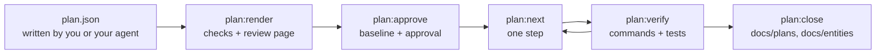

# 実装計画

実装計画は、変更の設計をコードより先に JSON で書いておくドキュメントです。Guren は計画をアプリケーションと突き合わせて検査し、レビュー用のページとして描画します。承認すると計画に基準点が刻まれ、作業はステップに分けられ、どこまで実装できたかはコードから読み取られます。進捗は実装したエージェントの自己申告ではなく、`plan:status` と `plan:verify` がスキーマ、ルートグラフ、コントローラー、ページ、テスト結果から判定します。

計画を書く価値があるのは、テーブルとルートとページにまたがる変更のように、できあがった差分を直すより設計の段階で直すほうが安く済む場合です。差分を一文で説明できる程度の変更なら、計画は要りません。

一連の流れを通して体験したい場合は、[エージェントと作る](../agent-course/00-overview.md) を読んでください。Claude Code と一緒に 2 本の計画を依頼からクローズまで進める講座で、判断が必要な場面ごとにチェック表を用意しています。



このページの例はすべて、投稿にコメント機能を足す 1 つの計画から取っています。コマンドは、Guren の[ブログのサンプル](https://github.com/gurenjs/guren/tree/main/examples/blog)のコピーで実行しています。

## 用語

このページでは、次の言葉を決まった意味で使います。詳しくはそれぞれの節で説明します。

| 用語 | 意味 |
|---|---|
| 要素 | 計画が名前を挙げるもの。モデル、カラム、ルート、アクション、validator、ページ、Resource、Policy、コマンド、副作用のどれかで、`model.comment` のような id を持つ（[id と change](./implementation-plan-format.md#id-と-change)） |
| change | 計画がその要素にすること。`add`、`alter`、`rename`、`drop`、参照するだけの `existing` |
| 振る舞い | `AC-comments-1` のような id を持つ受け入れ基準。テストになる（[受け入れ振る舞い](./implementation-plan-format.md#受け入れ振る舞い)） |
| 基準点(baseline) | 最初の承認が計画に刻むコミットと、要素ごとのハッシュ（[承認](#承認-planapprove)） |
| 計画のハッシュ | 計画と基準点から計算するハッシュ。承認、検証の記録、免除はこれを名指しするので、編集した計画は別の計画になる |
| 読み取り | `alter` の計画した性質が、承認時にどう読めたか（[`alter` の読み取り](./implementation-plan-verification.md#alter-の読み取り)） |
| タスク、ステップ | Guren が計画から組み立てる作業。おもにエンティティごとにタスクがあり、共有する作業にもタスクができる。タスクは 6 種類のステップに分かれる（[実装](#実装-plannext-と-planverify)） |
| 記録 | ステップの検証結果。`.guren/plans/` に置かれる |
| 状態 | 要素の進み具合。`planned`、`present`、`wired`、`verified`、`drifted`、`unjudged`、`blocked`、`waived` のどれか（[進捗を読む](#進捗を読む-planstatus)） |
| 到達 | 通った振る舞いが、ルートと期待するページから計画の参照をたどって、その要素まで達しているか（[規則](./implementation-plan-verification.md#要素が完了と数えられる条件)） |
| 鮮度 | 要素が依存するものが、基準点のときのままか（[鮮度](./implementation-plan-verification.md#鮮度)）。依存先が古くなったステップは、`plan:next` が保留する |
| 免除(waive) | 人が理由を付けて、要素を未完成のまま受け入れること（[要素を waive する](#要素を-waive-する-planwaive)） |

## 置き場所

計画は、`docs/plans/` の下に slug を名前にしたディレクトリを作って置きます。

| ファイル | 中身 | コミット |
|---|---|---|
| `docs/plans/comments/plan.json` | 計画そのもの | する |
| `docs/plans/comments/approvals.json` | `plan:approve` が記録したハッシュと、`alter` ごとの読み取り | する |
| `docs/plans/comments/decisions.json` | `plan:waive` が書く免除 (waiver) の記録 | する |
| `docs/plans/comments/revisions/0001.json` | `plan:revise` が書くリビジョン | する |
| `docs/plans/comments/plan.html` | `plan:render` が書くページ | しない |
| `.guren/plans/comments.state.json` | 検証結果と、いま取り組んでいるステップの印 | しない (自身を ignore します) |

ファイル名が `plan.json` の場合は、ディレクトリ名が slug になります。ファイル名は別の名前でも構いません。たとえば `comments.plan.json` なら slug は `comments` で、記録はその隣に `comments.approvals.json`、`comments.decisions.json`、`comments.revisions/` として置かれます。

描画したページは生成物なので、リポジトリには入れません。`create-guren-app` で作ったアプリの `.gitignore` には、次の 2 行が最初から入っています。それより前に作ったアプリでは、この 2 行を `.gitignore` に足してください。1 行目は `docs/plans/<slug>/` に置いた計画のページ、2 行目はアプリケーションのルートなどに置いた `<slug>.plan.json` のページに対応します。`plan:next` は既定の場所に書かれたページとその一時ファイルを無視します。ただし `-o` で別の場所に書いたページはただの未追跡ファイルとして扱われるので、そのツリーでは `plan:next` が実行を拒否します。

```text
docs/plans/**/*.html
*.plan.html
```

計画そのものと、承認・決定ログ・リビジョンの扱いはページとは違います。免除の記録は次にどのステップを渡すかを左右しますし、リビジョンは計画を変えるコミットに含めるものです。そのため `plan:next` は、これらのどれかが未コミットだと実行を拒否します。

## 計画を書く

JSON は、読者が自分で書くか、機能について話し合ったセッションのエージェントに書かせます。エージェントに渡す内容は `guren plan --print-prompt` で表示できます。依頼とこのページの規約を載せたプロンプトのあとに、計画の JSON Schema が続きます。このコマンドはモデルを呼ばず、何も実行しません。

```bash
bunx guren plan "comments on posts, authors can delete their own" --print-prompt
```

出力をセッションに貼り付けるか、エージェント自身にこのコマンドを実行させてください。プロンプトは、エージェントに次の順で作業するよう指示しています。まず `context`、`model:list`、`guidelines` でアプリケーションを読み、自分で決められないことを質問し、`docs/plans/<slug>/plan.json` を書いてから、失敗する検査がなくなるまで `plan:render --json` を実行します。承認は読者が行います。依頼を省いた場合、プロンプトは依頼内容を尋ねるようエージェントに指示します。`--json` を付けると、プロンプトとスキーマが 1 つのオブジェクトで出力されます。`--print-prompt` を付けずに `guren plan` を実行するとエラーで終わり、モデルに単独で計画を書かせる使い方はまだ用意していません (このページの最後を参照)。

エージェントハーネスを入れたアプリ (`bunx guren agent:init` で導入し、`agent:sync` で更新) では、この流れを `plan-write` スキルが進めます。エージェントに機能の計画を頼むと、書き始める前に設計を左右する点を質問してきます。答えを受け取るとプロンプトに沿って計画を書き、失敗する検査がなくなるまで `plan:render --json` を実行して、最後にページの場所と未決の点を伝えます。レビュー後の変更は `plan:revise` で記録し、承認まではしません。承認した計画は `plan-implement` スキルが実装します。

`plan:render` はファイルを計画のスキーマで検証し、誤りのあるフィールドを指摘します。

```text
 ERROR  The plan does not match the plan schema:
  models.0.columns.0.change.from: Invalid input: expected string, received undefined
```

計画のセクション、要素の id、受け入れ振る舞い、質問、コマンドについては、[実装計画の書き方](./implementation-plan-format.md)で説明しています。

## 描画と検査: `plan:render`

```bash
bunx guren plan:render docs/plans/comments/plan.json
```

実行すると `docs/plans/comments/plan.html` が書き出され、そのパスが表示されます。出力先は `-o` で変えられます。別のディレクトリから実行するときは、`--app <dir>` で検査するアプリケーションを指定してください。`--locale ja` を付けると、ページのラベルが日本語で表示されます。ページ上でも `en` と `ja` を切り替えられますが、計画の本文は翻訳されません。`--json` を付けるとページのパスとすべての検査が 1 つの JSON で出力されるので、エージェントはページを開かずに失敗した検査を読めます。

ページは 1 つのファイルで、ネットワークにはアクセスしません。ディスクから直接開けるので、レビュー依頼にそのまま添付できます。以下のラベルは `--locale ja` で開いたときの表記です。ページには、セクションごとのタブ、エンティティのフィルター、`existing` の要素を隠す「変更のみ」の切り替えがあります。現在のスキーマに計画を重ねた ER 図も描かれ、id はどれも参照先の要素へのリンクになっています。失敗した検査と互換性を壊す変更は、「確認が必要な項目」に固定で表示されます。要素ごとに「承認」と「修正を依頼」のボタンとコメント欄があり、レビュー結果はフッターから `feedback.json` として書き出せます。ページ上で何を操作しても、計画のファイルそのものは変わりません。「エージェントへの依頼文をコピー」を押すと、計画のパス、`plan-write` スキルでレビューを反映してほしいという依頼、フィードバックをまとめた依頼文が、ページの表示言語でコピーされます。これをエージェントに送れば、レビューがリビジョンとして計画に取り込まれます。`plan:revise` は `feedback.json` から承認と回答を読みます (後述)。コメントの内容は、読者かエージェントが計画のコピーに反映します。フッターには、計画を直したあとに実行する `plan:render` と `plan:approve` の 2 つのコマンドが表示されます。

検査は、今のアプリケーションに対して実行されます。報告される内容には、たとえば次のようなものがあります。

- 計画にないアクションを指すルート
- どこにも存在しないモデルへの外部キー
- 名前がすでに使われている `add`
- 存在しない `existing` や `alter` の対象
- 認証だけで認可のない、状態を変えるルート
- validator のない、ボディを受け取るルート
- 足りない振る舞い（[受け入れ振る舞い](./implementation-plan-format.md#受け入れ振る舞い)を参照）

検査が失敗しても描画は止まらず、先に進めなくなるのは `plan:approve` のほうです。基準点 (`baseline`) を持つ計画では、`plan:render` も承認と同じように計画自身が行った作業を差し引いて判定します。そのため、計画が作った要素との衝突は、ページ上では通過した検査として表示されます。例の削除ルートの名前を、ブログがすでに使っている名前に変えると、次のように報告されます。

```text
  route.comments.destroy: The route name "posts.destroy" already exists in this application.
```

計画が変更、名前の変更、削除をする要素については、それに依存しているアプリケーションの部分もページに一覧されます（[Impact](./implementation-plan-verification.md#impact)）。

## 承認: `plan:approve`

承認は、ページを読んだ人が下す判断です。検査が失敗しているか、質問が残っている場合、承認は拒否されます。

```text
 ERROR  docs/plans/comments/plan.json is not approved while a check fails or a question is open; an assumption nobody confirmed is not approved by silence.
  question Q-delete is unanswered: Does deleting a comment remove the row?
An answer chosen on the review page does not change the plan file. Send the agent the prompt the page copies with "Copy prompt for the agent", or remove each answered question yourself with plan:revise (--edited with a copy of the plan, or --ops with a remove op), passing the page's feedback with --feedback.
```

問題がなくなったら承認します。

```bash
bunx guren plan:approve docs/plans/comments/plan.json
```

```text
Comments on posts (plan.json)

Stamped the baseline at 0c871a5b9dc25587d33ae3d6bb6c3befe2c7e6a2: 14 element(s) hashed.
Approved 22735cb551ac15559cd5cabc344925f8f75af7a62efe39570ac49d8c032a59c0, recorded in docs/plans/comments/approvals.json.
```

最初に承認したときに、計画に `baseline` が書き込まれます。`rev` は計画を書いた時点のコミットで、`contextHash` は参照している要素ごとに、アプリケーションでの今の形をハッシュにしたものです。コミットのないリポジトリや、未コミットの変更がある作業ツリー (計画自身のファイルは除く) で承認が拒否されるのはこのためです。承認の記録は計画の中には入らず、隣の `approvals.json` に書かれます。両方をコミットしてください。

計画はハッシュで識別します。ハッシュは基準点を含めた計画の SHA-256 で、承認、検証の記録、免除の記録はどれもこのハッシュで計画を指します。承認後に編集した計画は、別の計画として扱われます。基準点を持つ計画の現在のハッシュがどの承認にも記録されていなければ、`plan:next`、`plan:scaffold`、`plan:verify`、`plan:waive`、`plan:close` はその計画を拒否します。

```text
 ERROR  docs/plans/comments/plan.json is not approved at its current hash dc9a6ce3ad173e23290f743293fa0e3495c932b3b2cdf07c0cda8c9b063a5465, so no step of it is handed out: it was edited after approval, or never approved, and what it says now may not be what anyone agreed to. Run guren plan:approve docs/plans/comments/plan.json once the plan says what you mean to build.
```

`plan:status` と `plan:render` は、承認する前に変更を読むためのコマンドなので、こうした計画でも拒否しません。基準点のない下書きにはハッシュがないので、`plan:next` と `plan:verify` は下書きをこれまでどおり受け付けます。`plan:scaffold` は承認された内容からコードを書くコマンドなので、下書きを拒否します。隣に承認の記録がある下書きは、未承認の計画と同じように拒否されます。承認済みの計画から `baseline` を消しても、この確認を避けることはできません。

計画は実装を始める前に承認してください。承認のときには、`alter` ごとに計画した性質がどう読めるかを記録するので、承認時点ですでに一致していた性質は変更の証拠になりません（[`alter` の読み取り](./implementation-plan-verification.md#alter-の読み取り)）。validator のハッシュの取り方と、実装の途中で編集した計画をもう一度承認するときの扱いは、[承認の詳細](./implementation-plan-verification.md#承認の詳細)にあります。

## 改訂: `plan:revise`

計画は、承認の前でも後でもリビジョンとして変更します。`plan:revise` はモデルを呼ばずにリビジョンを記録するコマンドで、親になるのは現在の計画ファイルそのものです。変更内容は、変更を加えた計画のコピーか、変更操作の一覧 (ops) として別に渡します。

```bash
cp docs/plans/comments/plan.json /tmp/comments.edited.json
# edit the copy: rename a column, change a type, drop a route
bunx guren plan:revise docs/plans/comments/plan.json --edited /tmp/comments.edited.json --message "soft-delete comments instead"
```

コマンドは 2 つのファイルの差分から変更操作を求めます。追加・変更・削除した要素ごとに操作が 1 つでき、どの操作も `--message` の内容を理由として持ちます。コマンドは `{ parent, ops, result }` を `docs/plans/comments/revisions/0001.json` に書き、そのあと `plan.json` をコピーの内容で置き換えます。`comments.plan.json` という名前の計画なら、リビジョンは `comments.revisions/` に置かれます。`--ops ops.json` を使えば、変更操作を直接渡せます。渡すのは `{ "ops": [...] }` の形の文書で、操作ごとに `reason` を書きます。

`--feedback feedback.json` を付けると、ページでのレビュー結果が制約として効きます (コピーしたテキストを渡す場合は `-` を指定します)。ページで承認した要素は、`--reopens "<reason>"` で理由を示したときだけ変更できます。ページで回答した質問は、改訂後の計画から消えていなければなりません。フィードバックから読むのはこの 2 つだけなので、コメントの内容はコピーに自分で反映してください。

承認後の計画は、この方法で変更します。`plan.json` をその場で編集すると、ハッシュがどの承認にもリビジョンにもない値に変わるので、`plan:revise` はその計画を拒否します。その場合は `git checkout -- docs/plans/comments/plan.json` で元に戻し、編集内容をコピーに移して `--edited` で渡してください。改訂したあと承認していない計画は、そのまま続けて改訂できます。リビジョンは基準点をそのまま引き継ぐので、改訂した結果は `plan:approve` で承認するまで `plan:next` などのコマンドに拒否されます。古いハッシュに対して記録した免除も引き継がれず、コマンドはその免除を一覧で示します。最初の承認前の下書きも同じ方法で改訂できますが、直接編集しても構いません。

実装済みの計画を改訂すると、ステップは確認し直しになります。詳しくは[実装済みの計画の改訂](./implementation-plan-verification.md#実装済みの計画の改訂)を参照してください。

## 実装: `plan:next` と `plan:verify`

作業の分け方と順序は、モデルではなく Guren が計画から自動で組み立てます。作業は、次のステップを尋ね、実装し、検証し、コミットする、という流れの繰り返しです。計画で足したり変えたりするエンティティごとにタスクができ、複数で共有する作業にも専用のタスクができます。タスクは、外部キーを含む要素どうしの参照の順に並びます。ステップは 6 種類あり、各タスクには作業のある種類のステップだけが入ります。

| ステップ | 作業 | 検証 |
|---|---|---|
| `commands` | 計画の `commands` (`guren add attachments` など)。`task/foundation` に入る | `codegen`、`typecheck` |
| `scaffold` | 新しいエンティティの最初の版。`plan:scaffold` が書く | `codegen`、`typecheck` |
| `tests` | 受け入れ振る舞いごとのテスト。`plan:scaffold` が雛形を書き、失敗する状態にする | `codegen`、テストが失敗すること |
| `data` | テーブル、マイグレーション、モデルのリレーションと fillable。scaffold 済みなら、マイグレーションと、`plan:scaffold` が書かなかったもの | `codegen`、`db:migrate`、`typecheck` |
| `http` | コントローラーとルート。validator、Resource、Policy も含む。scaffold 済みなら、`plan:scaffold` がスタブにしたものと書かなかったもの | `codegen`、`typecheck`、`guren check`、テストが通ること |
| `pages` | ページコンポーネント | `codegen`、`typecheck`、`guren check` |

作業は次のように分かれます。

- **テストを実行するのは、タスクごとに 1 つ、振る舞いを判定するステップだけです。** 最後の `http` ステップがそれにあたり、`http` がなければタスクの最後のステップになるので、`data` や `pages` でテストを実行することもあります。分割された `http` の前半を含め、ほかのステップではテストを実行しません。
- **分割された `http` ステップでは、最後のパートだけが `typecheck` を実行します。** 前半のパートが、後半のパートで書く Resource やジョブを import していることがあるためです。ほかの種類のステップは、表のとおりに実行します。
- **`http` のアクションが描画するページ**のうち `pages` ステップで追加するものは、ファイルができるまで `.guren/pages.gen.ts` に載りません。そこで `plan:next` はそのページを `http` ステップと一緒に表示します。このステップでは default export と計画の `Props` だけを持つスタブを作り、残りは `pages` ステップで書きます。
- **共有する作業**は `task/foundation` に入ります。ただしアクションは、コントローラーのクラスを複数のタスクで共有していても、そのアクションかそこへのルートを `covers` に挙げたタスクに入ります。そのため、タスクの `tests` ステップは、ルートやバリデーター、ミドルウェアをつなぐステップより先に来ます。複数のタスクが使うバリデーターやページも Foundation には入らず、それを使う最初のタスクに入り、ほかのタスクはそのタスクを待ちます。
- **ステップの id** は `task/entity/model.comment/http` のような形です。`commands`、`data`、`http`、`pages` のステップは、担当する要素が 5 つを超えるファイルにまたがると、`task/entity/model.comment/http/1`、`/2` のように分かれます。`scaffold` と `tests` は分かれません。`--step` に渡す正確な id は `plan:next` が表示します。

```bash
bunx guren plan:next docs/plans/comments/plan.json
```

```text
Comments on posts (plan.json)

Verified: task/entity/model.comment/scaffold

Next: task/entity/model.comment/tests
  task: entity Comment (task/entity/model.comment)
  verify: codegen → tests:fail

Write this step’s test skeletons with `bunx guren plan:scaffold docs/plans/comments/plan.json --step task/entity/model.comment/tests`, not by hand, then fill them in.
  It writes one TestApp test per behaviour (AC-comments-1, AC-comments-2, AC-comments-3, AC-comments-4), with its request and the expectations the plan states, into one file.
  Each fails at a given() call until the setup it names is written (records, the signed-in actor, path parameters); replace every call, and keep each title’s id and its request.

Behaviours to write, as test titles `[<id>] <description>`, failing:
  [AC-comments-1] A signed-in user can comment on a post.
      success; actor user; route route.comments.store; given a post exists; expect status 302; comments has 1 row(s)
  [AC-comments-2] An empty comment is rejected.
      validation; actor user; route route.comments.store; given a post exists; expect status 422; errors on body
  [AC-comments-3] A guest cannot comment.
      unauthenticated; actor guest; route route.comments.store; given a post exists; expect redirect /login
  [AC-comments-4] A user cannot delete someone else's comment.
      forbidden; actor user; route route.comments.destroy; given a comment written by another user exists; expect status 403
  Each test requests its route through a TestApp, in its body or a function of its file it calls: plan:verify reads the requests before it runs them.

Implement this step only, then run `bunx guren plan:verify docs/plans/comments/plan.json --step task/entity/model.comment/tests` and commit once it is verified.
Marked in .guren/plans/comments.state.json
```

`plan:next` が表示するのは 1 つのステップだけで、計画全体は出しません。`--json` を付けると、同じ内容をデータで返します。表示したステップには状態ファイルで印が付き、Stop フックはこの印を読みます。承認のない計画は、先に述べたとおり拒否されます。未コミットの変更がある作業ツリーも、その変更が印の付いたステップ自身の作業でない限り拒否されるので、`plan:next` はステップに取りかかる前に実行してください。

```text
 ERROR  The working tree under /app has uncommitted changes (paths relative to the repository root), and one step is one commit. Commit or discard them first:
  ?? tests/plans/comments/comments.test.ts
```

```bash
bunx guren plan:verify docs/plans/comments/plan.json --step task/entity/model.comment/tests
```

```text
task/entity/model.comment/tests: verified (607 ms)
  pass     codegen     bun run codegen
  pass     tests:fail  bun test tests/plans/comments/comments.test.ts
  failing  [AC-comments-1]
  failing  [AC-comments-2]
  failing  [AC-comments-3]
  failing  [AC-comments-4]
  work: 1 file, +38 -0 since 3f1c2a9b0d4e

Recorded in .guren/plans/comments.state.json
```

`work:` の行は、`plan:next` が印を付けてからそのステップで変わったファイル数と行数です（[ステップごとのファイル数と行数](./implementation-plan-verification.md#ステップごとのファイル数と行数)）。

`tests` ステップの検証が通るのは、すべての振る舞いにテストがあり、そのすべてが失敗したときだけです。コードより先に通ってしまうテストは何も証明しませんし、skip したテストは失敗に数えません。`plan:verify` は、ステップの id がソースに書かれたテストファイルを選んで `bun test` で実行します。後のステップでも同じファイルを実行し、今度は通ることを求めます。検証結果のあとには計画の状態が表示されますが、その読み方は後で説明します。

`plan:verify` は、テストを実行する前に、各振る舞いのテストがその振る舞いのルートにリクエストしているかを確かめます（[`plan:verify` によるテストのリクエストの読み取り](./implementation-plan-verification.md#planverify-によるテストのリクエストの読み取り)）。

### scaffold と tests のステップ

`plan:next` は、`scaffold` と `tests` のステップを手で書かずに `plan:scaffold` で書くよう指示し、scaffold ステップが書いたルートは `http` ステップで `plan:scaffold --mount` を使ってマウントするよう指示します。どちらも、あえて手を付けずに残すものがあります。キーがまだないリレーション、例外を投げる Resource のフィールド、`false` を返す Policy のメソッド、501 を返すアクション、例外を投げる `given()` で書かれたテストの前提です。それぞれが書き出すものと残すものは[計画からコードとテストを生成する](./implementation-plan-scaffolding.md)にあります。

### 結果

ステップの結果は次の 4 つのどれかです。

| 結果 | 意味 |
|---|---|
| `verified` | 検証済み。すべてのコマンドが通り、ステップが担当する要素がすべて完了の状態にある |
| `failed` | 失敗。コマンドが失敗しており、実装に直すところがある |
| `incomplete` | 未完了。コマンドは通ったが、まだ存在しない要素がある |
| `blocked` | 実行できなかった。環境の都合でコマンドを実行できなかった。`package.json` にないスクリプト、入っていないツール、タイムアウト、つながらないデータベース、マイグレーションの確認に使う drizzle-kit や drizzle の設定がない、drizzle-kit が答えを返さない、など |

それぞれの結果の例と、`data` ステップが `db:migrate` の前に行うマイグレーションの確認は、[ステップの結果の詳細](./implementation-plan-verification.md#ステップの結果の詳細)にあります。

`plan:verify` は、承認のない計画を何も実行しないうちに拒否するので、誰も合意していないハッシュのもとで結果が記録されることはありません。承認済みの計画に対しては、`plan:verify` はアプリケーションを実際に動かします。`bun test` はアプリケーションを起動し、`db:migrate` は設定されたデータベースを開きます。開発用かテスト用のデータベースに向けて実行し、本番のデータベースには向けないでください。各コマンドは 600 秒を過ぎると `blocked` になり、この時間は `--timeout <seconds>` で変えられます。`--step` を省くと全ステップを順に実行し、記録がまだ有効なステップは飛ばします。検証後にファイルが変わったステップは、次に述べるとおり最後に確かめ直します。`--ci` を付けると、実行したステップが 1 つでも検証を通らなければ終了コード 1 を返します。`--json` を付けると結果をデータで出力します。

### 一ステップ、一コミット

変更はステップが挙げる要素だけにとどめ、検証が通ったらコミットしてください。検証が通ったステップでは、担当する要素が入っているファイル、要素を取り付けるファイル (アクションに振り分けるルート、ページを返すコントローラー)、テストファイルの指紋が記録されます。そのどれかが変わると、ステップの要素は `drifted` になります。後のステップがそうしたファイルに書き込むことは珍しくありません。`routes/web.ts` の既存ルートの隣に足すルート、`db/schema.ts` のテーブル、Resource のフィールドなどです。例のコピーでは、`pages` ステップのあとのコミットで `CommentResource.ts` にフィールドを足しました。このファイルは `http` ステップで検証したものなので、`http` の要素の大半が `drifted` になりました。

```text
Routes
  drifted   add       comments.store             route.comments.store
      Verified 2026-09-22T10:18:13.443Z by task/entity/model.comment/http; changed since: app/Http/Resources/CommentResource.ts.
```

`http` の振る舞いを通してしか `verified` にならない要素 (コントローラーと Policy) は、`plan:status` が読み取った状態に戻りました。ファイルが変わったステップの振る舞いは、要素に届く経路として数えないためです ([要素が完了と数えられる条件](./implementation-plan-verification.md#要素が完了と数えられる条件)を参照してください)。

こうしたステップは、`plan:verify --step` で確かめ直します。指定したステップの検証が通ると、同じ実行の中で、ファイルが変わった前のステップをタスク順に確かめ直します。コマンドを実行するステップが検証を通らなかった時点で、確かめ直しは止まります。結果はそれぞれ記録され (`failed` なら壊れた箇所も添えます)、レポートの「Re-checked」の下に並びます。そのあと `plan:next` は、検証を通っていない最初のステップを返します。たいていは失敗したステップです。確かめ直しが `blocked` になったステップは、後の実行に回します。指定したステップ自体が検証を通らなければ、前のステップの記録には手を付けず、後の実行に回したステップとして示します。ステップ間で共有しているコマンドが失敗している以上、確かめ直しても同じ理由で失敗するからです。

`tests` ステップは、何も実行せずに確かめ直します。コードができたあとでは、テストが通ってしまうからです。各振る舞いの id を書いたテストファイルがちょうど 1 つずつあり、各振る舞いのテストが上と同じ読み方でまだそのルートへリクエストしていれば、`verified` のままです。そうでなければ、該当する振る舞いを示し、ステップを `drifted` のまま残します。

`plan:next` は何も実行しないので、次のステップが `drifted` であれば、確かめ直すよう伝えます。

```text
Verified before; files it was verified at have changed since: app/Http/Resources/CommentResource.ts.
Re-check it with `bunx guren plan:verify docs/plans/comments/plan.json --step task/entity/model.comment/http` rather than re-implementing it, fix only what that run reports, and commit once it is verified.
```

すべてのステップを検証し終えると、`plan:next` はそのことを伝えます。

```text
Every step is verified. Nothing is left to implement.
```

### Stop フック

エージェントハーネス (`bunx guren agent:init`) を入れたアプリケーションでは、`plan-implement` スキルがこのループを回し、Claude Code、Codex、Cursor の `Stop` フックが印の付いたステップを見張ります。エージェントがターンを終えるたびにフックがステップを検証し、検証が通らなければエージェントを作業に戻します。

```text
plan:verify on stop (docs/plans/comments/plan.json, task/entity/model.comment/data): the step is incomplete, so this turn is not done (continuation 1 of 3).
```

フックは、印の付いたステップを `plan:verify --step` と同じ実行で検証します。そのため、エージェントが止まってステップの検証が通るたびに、ファイルが変わった前のステップも確かめ直されます。この確かめ直しでは、作業に戻す回数 (continuation) は減りません。印の付いたステップの検証が通っても、その変更で前のステップが壊れていれば、フックはターンを終わらせ、壊れたステップを示します。

フックが諦めるのは、次のどれかに当てはまる場合です。

- 3 回戻しても終わらない
- 前回戻したときから、ステップに何の変化もない
- ステップかその要素が `blocked` になった
- ステップが依存する要素が、承認後に古くなった

諦めたステップは、行き詰まり (`stalled`) として記録されます。

```text
plan:verify on stop (docs/plans/comments/plan.json, task/entity/model.comment/data): giving up, nothing about the step changed since the last continuation.
```

`plan:next` は、行き詰まったステップを理由と一緒にもう一度返します。行き詰まりをどう解消するかは人が決めます。選択肢は、環境を直す、計画を編集して承認し直す、要素を免除する、の 3 つです。

承認後に計画が編集されていると、フックは次にエージェントが止まったときに作業へ戻さず、ステップを行き詰まりとして記録します。作業を続けても、計画が承認されることはないからです。それ以降は、エージェントが止まってもフックは何も言いません。編集した計画を承認するか、承認したときの内容に戻せば、`plan:next` がそのステップをもう一度渡します。

```text
plan:verify on stop (docs/plans/comments/plan.json, task/entity/model.comment/data): giving up, docs/plans/comments/plan.json is not approved at its current hash dc9a6ce3ad173e23290f743293fa0e3495c932b3b2cdf07c0cda8c9b063a5465, so the step is not verified against it: it was edited after approval, or never approved, and what it says now may not be what anyone agreed to. Run guren plan:approve docs/plans/comments/plan.json once the plan says what you mean to build.
The step is recorded as stalled; `bunx guren plan:next docs/plans/comments/plan.json` returns it once an approval names the plan's hash.
```

`plan-implement` スキルは、この拒否を報告して承認は人に任せるよう、エージェントに指示しています。

## 進捗を読む: `plan:status`

```bash
bunx guren plan:status docs/plans/comments/plan.json
```

`plan:status` は、要素を 1 つずつコードと比べます。ルートファイル、スキーマ、validator のファイルを import してソースを解析するだけで、アプリケーションの起動もコマンドの実行もせず、データベースも使いません。結果がどうであっても終了コードは 0 です。例の計画ですべてのステップを検証し終えた時点では、次のように表示されます。

```text
Validators
  verified  add       CommentPayloadSchema       validator.comment

Actions
  verified  add       CommentController.store    action.comments.store
  verified  add       CommentController.destroy  action.comments.destroy

Views
  verified  alter     posts/Show                 view.posts.show

Resources
  verified  add       CommentResource            resource.comment

Policies
  verified  add       CommentPolicy              policy.comment

Elements the plan changes: 16
  planned 0, present 0, wired 0, verified 16, drifted 0, unjudged 0, blocked 0, waived 0
```

| 状態 | 意味 |
|---|---|
| `planned` | まだコードにない。`alter` では読める性質がまだすべて違い、`drop` ではまだ残っている |
| `present` | コードにあり、スキャナーが読める計画上の性質がすべて一致している (`drop` なら存在しない) |
| `wired` | 到達できる。`createApp()` がマウントし、先に登録されたルートに横取りされないルート、そのルートが呼ぶアクション、そのアクションが返すページ、そのルートやアクションが検証に使う validator、アプリケーションがディスパッチ、発行 (emit)、登録、送信する副作用が該当する |
| `verified` | 検証済み。所属するステップの検証が通り、指紋を取ったファイルが変わっていない |
| `drifted` | 検証後に変更された、または一部はあるが性質が食い違っている |
| `unjudged` | 計画が書いた性質をどれも読み取れず (`alter` なら、食い違う性質がなく、読み取りに照らして数えられる一致もなく)、変更が起きたかどうかを判断できる材料がほかにない |
| `blocked` | ここでは判定できない。理由が添えられる |
| `waived` | 免除。人が理由を付けて、未完成のまま受け入れた |

どの性質を一致と数えるか、マウントされていても届かないルート、検証済みのステップが要素を完了させる条件は、[要素が完了と数えられる条件](./implementation-plan-verification.md#要素が完了と数えられる条件)にあります。

`unknown` のまま残った計画上の性質は、すべて「Planned, not checkable」の下に並びます。どのスキャナーも読まない性質、読んでも判定できない性質 (文字列としてしか比べられない型や、計画より緩い範囲など)、承認時にすでに一致していた `alter` の性質がここに入ります。Guren が判定できない部分が、ほかの通過した項目に紛れて見えなくなることはありません。

```text
Planned, not checkable:
  column.comment.postId: references.onDelete
  view.posts.show: form, actions, states
  resource.comment: field id type
  policy.comment: ability delete rule
```

基準点を持つ計画では、レポートの最後に承認の状態が表示されます。現在のハッシュの承認があればその日時と承認者が、なければ計画を拒否するコマンドの一覧が出ます。

```text
Not approved at this hash: plan:next, plan:scaffold, plan:verify, plan:waive, plan:close refuse the plan until guren plan:approve records an approval of it.
```

検証結果は、git が無視する `.guren/plans/` に置かれます。検証結果は、それを実行したマシンでだけ成り立つ事実だからです。新しく clone したリポジトリや CI では、その環境で `plan:verify` を実行するまで、どの要素も `wired` より先には進みません。

承認済みの計画では、`plan:status` は各要素の依存先が基準点のときのままかも報告し、`guren check --plan` は開いている計画をまとめて確認します。詳しくは[鮮度](./implementation-plan-verification.md#鮮度)を参照してください。

## 要素を waive する: `plan:waive`

この計画では仕上げない要素や、計画のどこからも判定できない要素は、人が理由を付けて未完成のまま受け入れられます。よくあるのは副作用です。たとえば例のコピーの計画に、`CommentController.store` から発行する `CommentPosted` イベントを足したとします。イベントは `wired` になり、`plan:close` は残った要素の 1 つとして次のように示します。

```text
  event.commentPosted: wired
    No planned property of it matched beyond its existence and no behaviour can reach it, so no plan:verify run lifts it: waive it with bunx guren plan:waive docs/plans/comments/plan.json event.commentPosted --reason "<why>"
```

副作用にはどの振る舞いも届かないので ([要素が完了と数えられる条件](./implementation-plan-verification.md#要素が完了と数えられる条件)を参照してください)、示される選択肢は免除だけです。

```bash
bunx guren plan:waive docs/plans/comments/plan.json event.commentPosted --reason "no behaviour can observe an emitted event; the listener's own plan tests the notification"
```

```text
Comments on posts (plan.json)

Waived event.commentPosted: no behaviour can observe an emitted event; the listener's own plan tests the notification

Recorded in docs/plans/comments/decisions.json
The decision log is committed with the plan. A waiver names this plan hash, so a revision does not inherit it.
```

要素は `waived` になり、`plan:verify` はステップの判定からその要素を外します。`plan:next` は、その要素を「Waived, not to be implemented」の下に並べます。免除で外れるのは要素の判定だけで、振る舞いが失敗すればステップは失敗したままです。コードで満たせない振る舞いがある場合は、計画を変更してください。`plan:waive` は次の場合に拒否します。

- `existing` の要素
- 計画にない id
- `plan:status` が判定しないセクション (flows、tasks、振る舞い、質問) の要素
- 基準点のない下書き
- 現在のハッシュがどの承認にも記録されていない計画
- `--reason` がない

`--remove` を付けると、指定した要素の免除を取り下げます。こちらは上の確認を行わないので、免除した要素を削った改訂版の計画にも使えます。`plan-implement` スキルは、行き詰まりを報告して免除の判断は人に任せるよう、エージェントに指示しています。

## 閉じる: `plan:close`

現在のハッシュの承認があり、計画で変更する要素がすべて `verified` か `waived` になったら、計画を閉じられます。そうなるまでは拒否され、残っている要素ごとに、何が完了を妨げているかと、それを進めるコマンドが次の行に示されます。次の出力は、上の `drifted` の例で `http` を確かめ直す前のものです (示された 8 つの要素のうち 2 つを抜き出しています)。

```text
 ERROR  docs/plans/comments/plan.json is not closed: every element must be verified or waived with a reason (guren plan:waive), and these are not, each with what holds it and what moves it:
  validator.comment: drifted (Verified 2026-09-22T10:18:13.443Z by task/entity/model.comment/http; changed since: app/Http/Resources/CommentResource.ts)
    Run bunx guren plan:verify docs/plans/comments/plan.json --step task/entity/model.comment/http again, since that run no longer holds; or waive it: bunx guren plan:waive docs/plans/comments/plan.json validator.comment --reason "<why>"
  controller.comments: present (Verified 2026-09-22T10:18:13.443Z by task/entity/model.comment/http, but no planned property of it matched beyond its existence and no verified run of a step whose behaviours reach it (task/entity/model.comment/http) holds now, so that result is not counted: run plan:verify on that step, or waive it)
    Run bunx guren plan:verify docs/plans/comments/plan.json --step task/entity/model.comment/http; or waive it: bunx guren plan:waive docs/plans/comments/plan.json controller.comments --reason "<why>"
```

`controller.comments` は `http` の振る舞いを通してしか `verified` にならないので、そのステップを確かめ直せば一緒に `verified` になります。完了の状態に届いていない要素や `blocked` の要素は、`plan:verify` を実行する前にコードや環境を直す必要があります。どの `plan:verify` の実行でも `verified` にならない要素には、`plan:waive` が示されます。足りないのが要素に届く振る舞いだけの場合は、振る舞いを足して計画を承認し直すという選択肢も示されます。ただし、カラム、コマンド、副作用に示されるのは免除だけです (「要素を waive する」の節を参照してください)。`plan:verify` が指紋を取れない要素も、どの実行でも `verified` にならないので、免除だけが示されます。すべてのステップを検証し終えたあとは `plan:next` も同じ行を表示するので、ループの最後にいるエージェントにも、計画を閉じられない理由がわかります。

すべての要素が `verified` か `waived` になったら、`--dry-run` で書き込まれる内容を確かめられます。問題がなければ計画を閉じます。

```bash
bunx guren plan:close docs/plans/comments/plan.json
```

```text
Comments on posts (plan.json)

  created       docs/plans/comments.md
  created       docs/entities/Post.md
  created       docs/entities/Comment.md

Closed 22735cb551ac15559cd5cabc344925f8f75af7a62efe39570ac49d8c032a59c0. The plan, its approvals and its decision log stay where they are, committed; docs/spec/ stays the description of record.
```

`docs/plans/comments.md` は計画の記録で、スコープ、前提、決定、各要素の最終状態、受け入れ振る舞いが書かれます。計画が触れたエンティティごとに `docs/entities/` の下にドキュメントが作られ、セクションごとにマーカーで囲んだブロックが入ります。

```markdown
## Rules

<!-- guren:plan comments 22735cb551ac15559cd5cabc344925f8f75af7a62efe39570ac49d8c032a59c0 rules -->
- A signed-in user can comment on a post. (AC-comments-1)
- An empty comment is rejected. (AC-comments-2)
- A guest cannot comment. (AC-comments-3)
- A user cannot delete someone else's comment. (AC-comments-4)
- The comment's author is the signed-in user. (AC-comments-1, AC-comments-2, AC-comments-3)
- The signed-in user wrote the comment. (AC-comments-4)
<!-- /guren:plan comments rules -->
```

マーカーの外の文章は自由に編集できます。同じエンティティについて後から別の計画を閉じても、置き換わるのはその計画自身のマーカーの中だけです。見出しは計画の `locale` に従い、`ja` の計画なら日本語で書かれます。ルールには、それを確かめる振る舞いの id が引用されます。どのテストにも書かれていない id を引用している場合は、`bunx guren check --docs` が警告します。免除を残したまま閉じた計画では、免除ごとに `make:adr` のコマンドも表示されるので、決定として残しておく価値のあるものに使ってください。閉じた計画は `check --plan` の対象から外れます。閉じるときに `docs/plans/<slug>.md` へ `closed: true` と計画のハッシュが書かれるためで、閉じたあとに承認した改訂版は、ふたたび開いた計画として扱われます。削除されるものはありません。計画、承認、決定ログはコミットされたまま残り、コードの現状を記述する役割は、引き続き `bunx guren spec:generate` が生成する `docs/spec/` が受け持ちます。

## まだ使えないもの

この機能の元になった RFC (`rfcs/0030-implementation-plans.md`) には、このページで紹介したコマンドより先のことも書かれています。次のものはまだ実装されていません。

- 計画の JSON を Claude に単独で書かせる `guren plan` (今あるのは `--print-prompt` だけです) と、レビューのコメントをリビジョンに変える `plan --revise`。自分で加えた変更は `plan:revise` で記録できます。`plan.json` は自分で書くか、エージェントとのセッションで書いてください
- 計画を `docs/plans/` ではなく GitHub の issue に置く方式
- `plan:scaffold` によるページの生成。計画で追加するスライスのうちページ以外はすべて書き、アクションの本体とレスポンスは `http` ステップに残します。ページは今後も生成しません。計画の props から書いたページは、作った時点で計画と一致してしまうためです

## 次のステップ

- [スペックアンカード開発](./spec-anchored.md): 閉じた計画が書き込むエンティティドキュメントとドキュメントリンク
- [テスト](./testing.md): 受け入れテストで使う `TestApp`、`actingAs()`、`withCsrf()`
- [CLI](./cli.md): ほかのコマンド
