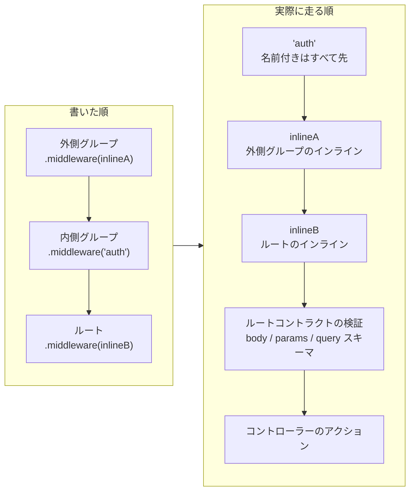

# ミドルウェアガイド

ミドルウェアは、リクエストの前後で処理を挟む仕組みです。コントローラーのアクションの前や後に処理を足したり、アクションの代わりにレスポンスを返したりできます。Guren は Hono のミドルウェアの仕組みをそのまま使っており、付ける場所は次の 3 つです。

| 付ける場所 | 適用される範囲 | 節 |
|------------|----------------|----|
| アプリケーション（`app.use()`） | すべてのリクエスト | [グローバルミドルウェア](#グローバルミドルウェア) |
| ルートやルートグループ（`.middleware()`） | そのルート | [ルートミドルウェア](#ルートミドルウェア) |
| 名前（`aliasMiddleware()` / `groupMiddleware()`） | その名前を使うルート | [ミドルウェアエイリアス](#ミドルウェアエイリアス)、[ミドルウェアグループ](#ミドルウェアグループ) |

`createApp({ auth })` で作ったアプリでは、セッション、CSRF、認証コンテキストのミドルウェアがすでにすべてのリクエストにマウントされています（[ビルトインヘルパー](#ビルトインヘルパー)を参照）。

## グローバルミドルウェア

```ts
// src/app.ts
import { createApp, defineMiddleware } from '@guren/core'

const requestTimer = defineMiddleware(async (ctx, next) => {
  const started = performance.now()
  await next()
  const duration = Math.round(performance.now() - started)
  console.log(`${ctx.req.method} ${ctx.req.path} -> ${ctx.res.status} (${duration}ms)`)
})

const app = createApp()
app.use('*', requestTimer)
```

グローバルミドルウェアは、ルートがマウントされる前に付けておく必要があります。そのため、サービスプロバイダーから付ける場合は `boot()` ではなく `register()` の中で `app.use()` を呼びます。ルートは `register()` と `boot()` の間にマウントされるので、`boot()` で付けたミドルウェアはそれらのルートでは実行されません。プロバイダーでの書き方は[アーキテクチャ](./architecture.md#サービスプロバイダ)を参照してください。

## ルートミドルウェア

```ts
import { Router, requireAuthenticated } from '@guren/core'
import DashboardController from '@/app/Http/Controllers/DashboardController'

export function registerWebRoutes(router: Router): void {
  router.get('/dashboard', [DashboardController, 'index']).middleware(
    requireAuthenticated({ redirectTo: '/login' }),
  )
}
```

ルートミドルウェアは、付けたルートだけに適用されます。グループに付けた場合は、そのグループ内のすべてのルートが対象です。`.middleware()` にはハンドラー関数と登録済みのエイリアス名のどちらも渡せ、両方を混ぜても構いません。ただし、混ぜると実行の順番が変わります（[実行順](#実行順)を参照）。

## ミドルウェアエイリアス

ミドルウェアの関数に短い名前を付けて登録しておくと、ルートファイルでは関数を毎回 import せずに名前で指定できます。

```ts
import { Router, requireAuthenticated } from '@guren/core'
import { requireAdmin } from '@/app/Http/middleware/admin'
import { csrfProtection } from '@/app/Http/middleware/csrf'

export function registerWebRoutes(baseRouter: Router): void {
  const router = baseRouter
    .aliasMiddleware('auth', requireAuthenticated())
    .aliasMiddleware('admin', requireAdmin())
    .aliasMiddleware('csrf', csrfProtection())
}
```

> [!IMPORTANT]
> `aliasMiddleware()` は、登録したエイリアス名を型に持つ**新しい `Router` 型**を返します。戻り値を受け取らずに呼ぶと名前が型に残らず、後の `.middleware('auth')` がコンパイルエラーになります。上の例のように、必ずチェーンして代入してください。
>
> この型は関数をまたいで引き継げます。[ルーティングのミドルウェアエイリアス](./routing.md#ミドルウェアエイリアス)を参照してください。

登録したエイリアスは、ミドルウェアを渡せる場所ならどこでも使えます。

```ts
router.get('/dashboard', [DashboardController, 'index']).middleware('auth')
router.post('/settings', [SettingsController, 'update']).middleware('auth', 'csrf')
```

エイリアスで登録したミドルウェアは、`guren audit` の報告にも名前で表示されます。フレームワークのガード（`requireAuthenticated()` と `requireGuest()`）はどちらの渡し方でも認識されますが、それ以外のミドルウェアを関数のまま渡すと `guren audit` からは見えません。

## ミドルウェアグループ

グループは、いっしょに使う複数のエイリアスを 1 つの名前にまとめたものです。グループに入れるものは、すべて登録済みのエイリアスである必要があります。

```ts
const router = new Router()
  .aliasMiddleware('auth', requireAuthenticated())
  .aliasMiddleware('session', createSessionMiddleware())
  .aliasMiddleware('csrf', createCsrfMiddleware())
  .aliasMiddleware('throttle', createRateLimitMiddleware({ limit: 60, windowMs: 60_000 }))
  .groupMiddleware('web', ['session', 'csrf'])
  .groupMiddleware('api', ['throttle'])
```

グループをまとめてルートに付けるには `router.middleware()` を使います。

```ts
router.middleware('web').group((web) => {
  web.get('/', [HomeController, 'index'])
  web.get('/about', [PagesController, 'about'])
  web.get('/contact', [PagesController, 'contact'])
})

router.middleware('api').group((api) => {
  api.get('/api/posts', [ApiPostController, 'index'])
  api.post('/api/posts', [ApiPostController, 'store'])
})
```

グループと個別のエイリアスは組み合わせられます。

```ts
router.middleware('web', 'auth').group((group) => {
  group.get('/profile', [ProfileController, 'show'])
  group.put('/profile', [ProfileController, 'update'])
})
```

## 実行順

ルートのミドルウェアは、次の順に実行されます。

1. ルートのチェーンにあるエイリアス名とグループ名（外側のグループから）
2. インラインのハンドラー関数（外側のグループから）
3. ルートの `body`、`params`、`query` スキーマの検証
4. コントローラーのアクション

名前で指定したものが関数より先に動く規則は、1 回の `.middleware()` の中だけでなく、グループをまたいでも同じです。そのため、外側のグループに書いたインラインハンドラーは、内側のグループの名前付きミドルウェアより**後**に実行され、コードの見た目とは逆の順になります。



前後関係が問題になる場合は、すべてをエイリアスとして登録してください。最後の 2 段は並べ替えられません。ルートに付けたスキーマは、すべてのミドルウェアが終わったあと、アクションの直前に必ず検証されます。

## ビルトインヘルパー

| ヘルパー | 役割 | 自動でマウントされる条件 |
|----------|------|--------------------------|
| `defineMiddleware` | Hono のミドルウェア関数に Guren 用の型を付ける | — |
| `createSessionMiddleware` | 各リクエストにセッションを付ける | `createApp({ auth })` のとき |
| `createCsrfMiddleware` | 状態を変えるリクエストの CSRF トークンを検査する | `createApp({ auth })` のとき |
| `attachAuthContext` | 各リクエストに認証コンテキストを付ける | 常に |
| `requireAuthenticated` / `requireGuest` | ログイン済みのユーザーだけ／ゲストだけを通す | なし（ルートに付ける） |
| `createRateLimitMiddleware` | クライアントごとのリクエスト数を制限する | なし（ルートに付ける） |

### `createSessionMiddleware`

リクエストのコンテキストにセッションを付けます。セッション ID は署名付きの Cookie で受け渡し、データはストアを渡さなければメモリ（`MemorySessionStore`）に保存します。自分でマウントするのは、`auth` オプションを使わないアプリの場合だけです。

```ts
import { createSessionMiddleware } from '@guren/core'

app.use('*', createSessionMiddleware())
```

セッションは `getSessionFromContext(ctx)` か `ctx.get('guren:session')` で取り出します。

`store` には `SessionStore` そのものか、それを返す関数を渡します。関数はリクエストのたびに呼ばれるので、ランタイムのバインディング（Workers）や接続（Redis）が必要なストアを起動時に組み立てずに済みます。組み立てが重い場合は自分でメモ化してください。複数のストアを宣言して環境ごとに切り替えるには `SessionManager` を使います（[認証](./authentication.md#sessionmanager-でストアを選ぶ)を参照）。

### 認証ガード

`requireAuthenticated` と `requireGuest` は、アプリケーションがすべてのリクエストに付けている認証コンテキストを読みます。そのため、ルートにはガードを付けるだけで済みます。

```ts
import { Router, requireAuthenticated, requireGuest } from '@guren/core'

const router = new Router()
  .aliasMiddleware('auth', requireAuthenticated({ redirectTo: '/login' }))
  .aliasMiddleware('guest', requireGuest({ redirectTo: '/dashboard' }))

router.middleware('auth').group((auth) => {
  auth.get('/settings', [SettingsController, 'index'])
  auth.get('/dashboard', [DashboardController, 'index'])
})
```

`redirectTo` が効くのはブラウザーからのリクエストだけです。エージェントのツール呼び出し（[エージェントインターフェース](./agent-interface.md)を参照）はリダイレクトをたどれないので、どちらのガードも JSON で拒否を返します。ステータスは `requireAuthenticated` が `401`、`requireGuest` が `403` で、`status` を渡した場合はその値です。このとき、`redirectTo` と一緒に設定した `responseFactory` も使われません。

### CSRF 保護

CSRF ミドルウェアは、状態を変えるリクエスト（POST、PUT、PATCH、DELETE）のトークンを検査します。`createApp({ auth })` がすべてのリクエストにマウントするので、手で付けるのは `auth` オプションを使わないアプリの場合だけです。

```ts
const router = new Router().aliasMiddleware('csrf', createCsrfMiddleware())

router.middleware('csrf').group((csrf) => {
  csrf.post('/posts', [PostsController, 'store'])
})
```

フォームやリクエストへのトークンの入れ方は [CSRF 保護](./csrf.md)を参照してください。

### レート制限

ルートやグループにレート制限を付けます。

```ts
import { createRateLimitMiddleware } from '@guren/core'

const router = new Router().aliasMiddleware('throttle', createRateLimitMiddleware({ limit: 60, windowMs: 60_000 }))

router.middleware('throttle').group((throttle) => {
  throttle.post('/api/login', [AuthController, 'login'])
})
```

キー、ストア、レスポンスヘッダーについては[レート制限](./rate-limiting.md)を参照してください。

## カスタムミドルウェアを書く

ミドルウェアは `defineMiddleware` で作ります。ログイン中のユーザーは認証コンテキストから読みます。

```ts
import { AUTH_CONTEXT_KEY, defineMiddleware } from '@guren/core'
import type { AuthContext } from '@guren/core'

export const requireSubscription = defineMiddleware(async (ctx, next) => {
  const auth = ctx.get(AUTH_CONTEXT_KEY) as AuthContext | undefined
  const user = await auth?.user<{ isSubscribed: boolean }>()

  if (!user?.isSubscribed) {
    return ctx.json({ error: 'Subscription required' }, 403)
  }

  await next()
})
```

`app/Http/middleware/` に置いてエイリアスとして登録すれば、名前で使えます。

```ts
import { Router } from '@guren/core'
import { requireSubscription } from '@/app/Http/middleware/subscription'

const router = new Router().aliasMiddleware('subscribed', requireSubscription)

router.middleware('subscribed').group((group) => {
  group.get('/premium', [PremiumController, 'index'])
})
```
