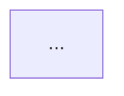

# Web

Welcome to your new Guren application. This template ships with Inertia server-side rendering enabled out of the box.

## Prerequisites

- [Bun](https://bun.sh/) installed locally.
- No database server. Local development uses SQLite at `SQLITE_DATABASE_PATH` (`./data/guren.db` by default); production runs on Cloudflare D1 through the `DB` binding in `wrangler.jsonc`.

## Quickstart

1. Install dependencies from the repository root: `bun install`.
2. Copy environment: `cp .env.example .env` and set `APP_KEY`, which is required to boot.
3. Generate route and page manifests once so the client picks up links: `bun run codegen`.
4. Start dev servers (Bun API + Vite dev server with hot reload): `bun run dev`.

During development the Bun server reads `resources/js/ssr.tsx` directly. Production builds rely on the Vite-generated SSR bundle and manifest, wired automatically by `src/main.ts` through `@guren/core/runtime`.

## Scripts

- `bun run dev` — start Bun API + Vite dev server together.
- `bun run build` — build both the client and SSR bundles with Vite.
- `bun run preview` — serve the built app through the Bun production server locally.
- `bun run codegen` — regenerate route helpers and page manifests from `routes/web.ts`.
- `bun run routes:types` — compatibility alias for `bun run codegen`.
- `bun run typecheck` — TypeScript no-emit type check (includes tests).
- `bun run test` — run Vitest suite via @guren/testing helpers.
- `bun run db:make` — scaffold a new SQL migration from your schema using drizzle-kit.
- `bun run db:migrate` — apply database migrations.
- `bun run db:seed` — execute seeders.

## Testing & Verification

Run the following before opening a PR:

```bash
bun run codegen
bun run typecheck
bun run test
bun run build
```

Code generation should leave no diffs after committing. The GitHub Actions workflow (`.github/workflows/ci.yml`) enforces the same steps on pushes and pull requests.

### Interactive Diagrams in the Docs

A mermaid diagram in `docs/en` or `docs/ja` can be upgraded to a React component on guren.dev. Put a marker on its own line directly above the fence:

````md
<!-- interactive: plan-lifecycle -->


````

GitHub hides the comment and keeps rendering the mermaid, which is also what the search index, `llms-full.txt` and a reader without JavaScript get. On the site, `app/Services/doc-interactive.ts` wraps the fence in a placeholder and `pages/Docs/Show.tsx` mounts the component into it, loading it only on pages that have one. To add a diagram:

1. Add its name to `config/interactive-diagrams.ts`. A marker naming anything else fails the render.
2. Write the component under `resources/js/components/diagrams/` and register its loader in `registry.ts`. The type requires one for every name.
3. Keep the mermaid fence showing the same flow, so the fallback stays true.

A diagram earns interactivity when the reader needs to follow a sequence or a loop, or to look at one part at a time (who acts at each stage, what each step writes). A diagram that reads in one glance stays plain mermaid. Components take `locale`, use the `--g-*` / `--docs-*` tokens so dark mode follows, work at 375px, keep motion behind `prefers-reduced-motion: no-preference`, and link to the guide's sections rather than repeating them. `plan-lifecycle` (the implementation plans guide) is the reference.

### Production Builds

Run `bun run build` before deploying. This script internally executes `bunx vite build` and `bunx vite build --ssr` so the Bun server can stream pre-rendered HTML during the first request. After building, `bun run preview` starts the same Bun server in production mode against the generated manifests instead of using Vite's static preview server.

Tailwind CSS is ready to use out of the box. Edit `resources/css/app.css` or add utilities to your components and the dev server will pick them up automatically.

Happy hacking!
