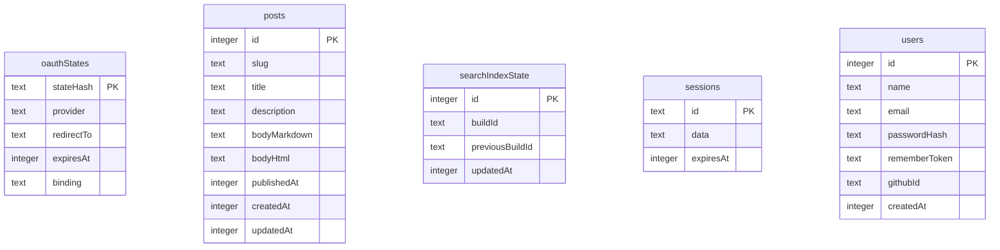

<!-- Generated by `bunx guren spec:generate` — do not edit by hand. -->

# ER Diagram

Entities and attributes are derived from `db/schema.ts` (and every module schema); edges from model relationship declarations and explicit `.references()` foreign keys.

This is a minimal, diff-able view. For interactive exploration of the Drizzle schema, tools like drizzle-lab or Liam ERD complement it.

## oauthStates (table: oauth_states)

| Column | Type | Constraints |
|--------|------|-------------|
| stateHash | text | primary key |
| provider | text | not null |
| redirectTo | text |  |
| expiresAt | integer | not null |
| binding | text |  |

## posts

| Column | Type | Constraints |
|--------|------|-------------|
| id | integer | primary key |
| slug | text | not null |
| title | text | not null |
| description | text |  |
| bodyMarkdown | text | not null |
| bodyHtml | text | not null |
| publishedAt | integer |  |
| createdAt | integer | not null |
| updatedAt | integer | not null |

## searchIndexState (table: search_index_state)

| Column | Type | Constraints |
|--------|------|-------------|
| id | integer | primary key |
| buildId | text | not null |
| previousBuildId | text |  |
| updatedAt | integer | not null |

## sessions

| Column | Type | Constraints |
|--------|------|-------------|
| id | text | primary key |
| data | text | not null |
| expiresAt | integer | not null |

## users

| Column | Type | Constraints |
|--------|------|-------------|
| id | integer | primary key |
| name | text | not null |
| email | text | not null |
| passwordHash | text |  |
| rememberToken | text |  |
| githubId | text |  |
| createdAt | integer | not null |
