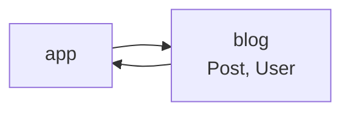

<!-- Generated by `bunx guren spec:generate` — do not edit by hand. -->

# Modules

Application modules under `modules/`, the models each owns, and the dependencies between them — derived from the directory layout and static imports, not this document.

## app

Depends on: blog

Models (0):

- none

## blog

Depends on: app

Models (2):

- Post — modules/blog/app/Models/Post.ts
- User — modules/blog/app/Models/User.ts
